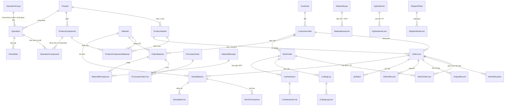

# NX-MTD – Mô tả cơ sở dữ liệu

Tài liệu mô tả database **NXMTD** (SQL Server) theo script `NX-MTD_Database.sql` **bản 25/10/2026**. Phần chi tiết cột của từng bảng được sinh trực tiếp từ script nên khớp với DDL; phần tổng quan và luồng nghiệp vụ tóm tắt cách các bảng nối với nhau.

| Hạng mục | Số lượng |
|---|---|
| Bảng | 70 |
| View | 19 |
| Hàm | 3 |
| Trigger | 29 |
| Thủ tục (stored procedure) | 5 |

**Mục lục**

1. [Quy ước chung](#1-quy-ước-chung)
2. [Bức tranh tổng thể](#2-bức-tranh-tổng-thể)
3. [Các luồng dữ liệu chính](#3-các-luồng-dữ-liệu-chính)
4. [Chi tiết bảng theo phân hệ](#4-chi-tiết-bảng-theo-phân-hệ)
5. [View](#5-view)
6. [Hàm, trigger, thủ tục](#6-hàm-trigger-thủ-tục)
7. [Dữ liệu danh mục mẫu](#7-dữ-liệu-danh-mục-mẫu)
8. [Phụ lục: danh sách khóa ngoại giữa các bảng](#8-phụ-lục-danh-sách-khóa-ngoại-giữa-các-bảng)
9. [Lịch sử thay đổi](#9-lịch-sử-thay-đổi)

---

## 1. Quy ước chung

- **Tên bảng / cột** tiếng Anh, PascalCase, dùng thẳng với EF Core (.NET 9). Khóa chính là `<Tên bảng>Id` kiểu `INT IDENTITY`, trừ `SystemSetting` (khóa là `SettingKey`) và `AccountingPeriod` (`PeriodId`).
- **Trạng thái và danh mục cố định** (ca, size, loại đơn từ, lý do lỗi, khoản chi phí…) lưu dạng mã chữ `VARCHAR` có `CHECK`, không tách bảng danh mục riêng. Giá trị hợp lệ ghi ở cột "Ràng buộc".
- **Kiểu số:** số lượng sản phẩm / bán thành phẩm (BTP) là `INT`; số lượng nguyên vật liệu (NVL) là `DECIMAL(18,3)`; định mức `DECIMAL(18,4)`; tiền `DECIMAL(18,2)` (VND).
- **Thời điểm** lưu theo giờ Việt Nam qua hàm `dbo.fn_VnNow()` (server chạy UTC vẫn đúng giờ chốt suất ăn 08:30).
- **Không xóa cứng dữ liệu master** (GBR-14): dùng cột `Status` (`ACTIVE` / `DISCONTINUED`, `ACTIVE` / `RESIGNED`…).
- **Khóa lạc quan:** bảng hay bị sửa đồng thời có cột `RowVer ROWVERSION`.
- **Lịch sử thay đổi** (ai, lúc nào, giá trị cũ / mới, lý do) ghi vào `AuditLog`, không có bảng lịch sử riêng cho từng bảng.
- **Tồn kho**: `StockBalance` giữ tồn hiện tại, mỗi mặt hàng trong mỗi kho một dòng; thẻ kho `StockTransaction` chỉ thêm. Cả hai chỉ được ghi qua `usp_Stock_Post`, nên tồn luôn bằng tổng thẻ kho. Giữ chỗ và khả dụng tính ở view `vw_StockBalance` (25/10).
- **Khóa tháng:** dữ liệu sản xuất, chấm hộ, chi phí thuộc tháng đã khóa (`AccountingPeriod.Status = 'LOCKED'`) bị trigger chặn ghi.
- **NVL được nhận diện bằng cặp (`MaterialId`, `MaterialColor`)** ở mọi nơi (đơn, định mức, đơn mua, phiếu nhập, phiếu cấp, thẻ kho). `MaterialColor = ''` là NVL không phân màu (khóa, nhãn…).
- **Dòng đơn `OrderLine` (một biến thể mã hàng – màu – size)** là đơn vị trung tâm cho cắt, sản lượng, QC, kho BTP / thành phẩm và giao hàng.

Ký hiệu trong bảng cột: **PK** khóa chính; **FK →** khóa ngoại; **FK ghép** khóa ngoại nhiều cột (xem mục "Ràng buộc & index" của bảng); cột *Null* có dấu ✓ là cho phép NULL; kiểu *tính toán* là computed column.

---

## 2. Bức tranh tổng thể

| Phân hệ | Bảng | Vai trò |
|---|---|---|
| 4.1 Danh mục & cấu hình | `Role`, `SystemSetting`, `GradeLevel` | Vai trò, tham số hệ thống, bậc thợ |
| 4.2 Nhân sự & thông báo | `Team`, `Employee`, `Account`, `GradeEvaluation`, `Announcement`, `AnnouncementTarget`, `Notification` | Tổ, nhân viên, tài khoản, đổi bậc thợ, thông báo |
| 4.3 Mã hàng, đơn hàng, định mức | `Customer`, `Material`, `Supplier`, `Product`, `ProductVariant`, `ProductComponent`, `ProductComponentMaterial`, `CustomerOrder`, `OrderLine`, `OrderMaterial`, `OperationGroup`, `Operation`, `OperationComponent`, `PieceRate`, `KpiTarget` | Dữ liệu gốc của sản xuất |
| 4.4 Đơn từ | `Request`, `RequestLine` | 10 loại đơn từ, gồm yêu cầu NVL / BTP / cắt bù / thiếu NVL |
| 4.5 Nhập NVL | `PurchaseOrder`, `PurchaseOrderLine`, `MaterialReceipt`, `MaterialReceiptLine` | Đơn mua, thanh toán, phiếu nhập |
| 4.6 Cắt & cấp kho | `WorkOrder`, `WorkOrderLine`, `MaterialIssue`, `MaterialIssueLine`, `MaterialReturn`, `MaterialReturnLine`, `CuttingLay`, `CuttingLayLine`, `CutHandover`, `CutHandoverLine` | Lệnh cắt, cấp NVL / BTP, trả vải, bàn cắt, bàn giao BTP |
| 4.7 May & QC | `OperationAssignment`, `WorkAllocation`, `OutputRecord`, `DefectRecord`, `QcBatch`, `FgHandover`, `FgHandoverLine` | Phân công, giao / thu hồi việc, sản lượng, hàng lỗi, QC, bàn giao thành phẩm |
| 4.8 Xuất hàng | `DispatchNote`, `DispatchNoteLine` | Phiếu xuất kho thành phẩm kiêm lệnh giao |
| 4.9 Kho | `StockBalance`, `Stocktake`, `StocktakeLine`, `StockTransaction` | Tồn hiện tại, kiểm kê, thẻ kho |
| 4.10 Chấm công & suất ăn | `AttendanceSyncSession`, `AttendanceLog`, `AttendanceAdjustment`, `DailyTimesheet`, `DailyMeal`, `TeamMealConfirmation` | Đồng bộ Ronald Jack Pro, bảng công, suất ăn |
| 4.11 Kế toán | `AccountingPeriod`, `Payroll`, `Payslip`, `PayslipItem`, `MonthlyCost`, `BreakEvenResult` | Kỳ kế toán, lương, chi phí, hòa vốn |
| 4.12 Xe | `Vehicle`, `VehicleTrip` | Chuyến xe, nhiên liệu |
| 4.13 Hệ thống | `Attachment`, `AuditLog` | Tệp đính kèm, nhật ký thay đổi |

### Sơ đồ quan hệ phần lõi (mã hàng → đơn → NVL → sản xuất → kho)

---

## 3. Các luồng dữ liệu chính

### 3.1 Mã hàng và định mức (cập nhật 23/10)

1. `Product` là mã hàng (style). Mỗi mã hàng khai báo các **biến thể** `ProductVariant` (một màu × một size) và các **thành phần** `ProductComponent`: chi tiết cắt từ vải (`PANEL`: thân trước, tay áo ×2…) hoặc phụ liệu (`TRIM`: khóa, nhãn, chỉ…).
2. `ProductComponentMaterial` là định mức: với **từng biến thể × từng thành phần**, dùng NVL nào, màu NVL nào, bao nhiêu cho 1 sản phẩm, % hao hụt và kích thước chi tiết (`LengthCm`, `WidthCm`, `SpecNote`). Ví dụ áo Xanh – S có tay áo dài 58 cm, vải Trắng; áo Đen – M có tay áo dài 60 cm, vải Đen.
3. FK ghép `(ProductVariantId, ProductId)` và `(ProductComponentId, ProductId)` bảo đảm biến thể và thành phần của một dòng định mức thuộc cùng một mã hàng.
4. `OrderLine` trỏ thẳng `ProductVariantId` (FK ghép cùng `ProductId`), nên đơn hàng chỉ dùng được biến thể đã khai báo; màu, size đọc từ `ProductVariant`.

### 3.2 Đơn hàng và NVL

1. `CustomerOrder` → các `OrderLine` (mã hàng – màu – size – số lượng – đơn giá CMT).
2. `OrderMaterial`: mỗi dòng là một NVL + màu mà đơn cần. `RequiredQty` theo số khách báo, `CustomerQty` là phần khách cấp; `PurchaseQty` và `Source` (`SUPPLIER` / `CUSTOMER` / `BOTH`) là cột tính.
3. `OrderMaterial` và định mức không nối bằng FK mà khớp theo `(MaterialId, MaterialColor)`; view `vw_OrderMaterialNorm` đặt số khách báo cạnh số tính từ định mức để phát hiện lệch.
4. Phần phải mua: `PurchaseOrder` / `PurchaseOrderLine` trỏ về `OrderMaterial`. Đơn mua dùng chung nhiều đơn (kim, chỉ…) có `OrderId` NULL và dòng ghi thẳng `MaterialId` + `MaterialColor` (TH-12).
5. Nhập kho: `MaterialReceipt` / `MaterialReceiptLine` (số đạt nhập kho). Số thiếu so với đơn mua xem `vw_PurchaseOrderLineStatus`. Thiếu / lỗi sinh `Request` loại `SHORT_DELIVERY`; phiếu bổ sung có `ShortageRequestId`.
6. Mỗi dòng phiếu nhập được xác nhận gọi `usp_Stock_Post` kho `MATERIAL`: cộng `StockBalance` và ghi một dòng `StockTransaction`.

### 3.3 Cắt

1. `WorkOrder` (lệnh cắt) cho tổ cắt theo đơn + mã hàng; `WorkOrderLine` là số cần cắt theo dòng đơn. Dòng cắt bù có `WorkOrderLine.ProductComponentMaterialId` (chi tiết × vải × màu của đúng màu × size); lệnh cắt bù có `SourceRequestId` trỏ về yêu cầu `REPLACEMENT_CUTTING`.
2. Vải cần cho lệnh cắt tính từ định mức qua `vw_WorkOrderFabricNeed`.
3. Thủ kho cấp vải bằng `MaterialIssue` (`WarehouseType = 'MATERIAL'`): xuất chỉ **giữ chỗ**, trừ kho khi tổ trưởng xác nhận nhận. Vải thừa trả lại bằng `MaterialReturn`.
4. Tổ cắt ghi `CuttingLay` (số lớp, màu vải) và `CuttingLayLine` (tỉ lệ size → số cắt; bàn của lệnh cắt bù ghi `CuttingLayLine.ProductComponentMaterialId`, vải của dòng định mức phải trùng `CuttingLay.FabricMaterialId` và `CuttingLay.FabricColor`). Tiến độ từng dòng lệnh cắt xem `vw_WorkOrderLineProgress`.
5. `CutHandover` bàn giao BTP vào kho BTP (`usp_Stock_Post` kho `SEMI_FINISHED`).

### 3.4 May, QC và thành phẩm

1. Kho cấp BTP cho tổ may bằng `MaterialIssue` (`WarehouseType = 'SEMI_FINISHED'`, dòng theo `OrderLineId`), thường theo `Request` loại `SEMI_FINISHED_REQUISITION`.
2. Tổ trưởng phân công công đoạn (`OperationAssignment`), rồi giao việc cho công nhân (25/10):
   - Mỗi sản phẩm qua mỗi công đoạn một lần, nên số lần cần làm của một công đoạn × màu × size = số bộ BTP tổ đã nhận (`MaterialIssueLine.ConfirmedQty`).
   - Tổ trưởng chia số lần đó cho công nhân tùy ý (`WorkAllocation.Quantity`); tổng số lần đang giao không vượt số bộ đã nhận (50050). Công đoạn có `Operation.UsesSemiFinished` = 1 thì giao kèm BTP (`WorkAllocation.PieceQty`, màn hình điền sẵn bằng số lần, sửa được); công đoạn không dùng BTP thì `WorkAllocation.PieceQty` = 0.
   - Trần sản lượng của công nhân là số lần được giao (`vw_WorkerOutputCap`); báo vượt bị chặn (50052). Tồn BTP của tổ (`vw_TeamPieceHolding`) chỉ trừ BTP giao kèm. Công đoạn còn bao nhiêu lần chưa giao xem `vw_OperationAllocationProgress`.
3. Sản lượng cuối ca `OutputRecord` khóa đơn giá bằng `PieceRateId`; hàng lỗi `DefectRecord` (`REWORK` / `SCRAP`). Scrap sinh yêu cầu cắt bù.
4. QA/QC ghi hàng đạt theo đợt (`QcBatch`) và bàn giao vào kho thành phẩm (`FgHandover`).
5. Quản đốc lập phiếu xuất `DispatchNote` (giữ chỗ), Thủ kho xác nhận xuất (trừ kho), Kế toán xác nhận khách đã nhận.

### 3.5 Chấm công, suất ăn, lương, chi phí

1. JOB-01 đọc Ronald Jack Pro mỗi ~10 phút (`AttendanceSyncSession`, `AttendanceLog`) → `usp_Attendance_IngestBatch` → `usp_Attendance_RebuildTimesheet` tính `DailyTimesheet`. Kế toán chấm hộ qua `AttendanceAdjustment` / `usp_Attendance_ApplyAdjustment`.
2. Suất ăn ngày `DailyMeal` + xác nhận của từng tổ `TeamMealConfirmation`; tự chốt 08:30, tổng suất xem `vw_DailyMealTotal`.
3. Lương tháng: dữ liệu xuất cho Kế toán ở `vw_PayrollExportData`, kết quả import vào `Payroll` / `Payslip` / `PayslipItem`, Admin duyệt.
4. Chi phí tháng `MonthlyCost` và kết quả hòa vốn theo mã hàng `BreakEvenResult`, theo `AccountingPeriod`.

---

## 4. Chi tiết bảng theo phân hệ

### 4.1 Danh mục & cấu hình

Vai trò người dùng (9 vai trò), tham số hệ thống dạng khóa – giá trị và bảng tiền bậc thợ A–D có ngày hiệu lực.

### `Role` — Vai trò (9 vai trò, gồm Tổ trưởng và Tổ phó)

> 9 vai trò (Report-1 FE-12, SRS I.4.1; 18/10: gộp Tổ trưởng cắt / may thành TEAM_LEADER, thêm Tổ phó).
> Tổ cắt hay tổ may do Team.TeamType quyết định, quyền theo (vai trò, loại tổ) do backend ghép.

| Cột | Kiểu | Null | Ràng buộc / mặc định | Ghi chú |
|---|---|:-:|---|---|
| `RoleId` | INT |  | **PK**; tự tăng |  |
| `RoleCode` | VARCHAR(30) |  | UNIQUE |  |
| `RoleName` | NVARCHAR(100) |  |  |  |
| `IsProduction` | BIT |  | Mặc định `0` | khối sản xuất (PRODUCTION_STAFF) |

### `SystemSetting` — Tham số hệ thống

> Tham số hệ thống (giờ chốt cơm, % cắt dư, chu kỳ đồng bộ…)

| Cột | Kiểu | Null | Ràng buộc / mặc định | Ghi chú |
|---|---|:-:|---|---|
| `SettingKey` | VARCHAR(50) |  | **PK** |  |
| `SettingValue` | NVARCHAR(200) |  |  |  |
| `Description` | NVARCHAR(500) | ✓ |  |  |
| `UpdatedAt` | DATETIME2(0) |  | Mặc định `(dbo.fn_VnNow())` |  |

### `GradeLevel` — Bậc thợ A–D và tiền bậc theo ngày hiệu lực

> Bậc thợ A–D và tiền bậc theo tháng, có ngày hiệu lực; giữ phiên bản cũ (GRADE_LEVEL, UC15)

| Cột | Kiểu | Null | Ràng buộc / mặc định | Ghi chú |
|---|---|:-:|---|---|
| `GradeLevelId` | INT |  | **PK**; tự tăng |  |
| `GradeCode` | CHAR(1) |  | Giá trị: `A`, `B`, `C`, `D` |  |
| `GradeName` | NVARCHAR(50) |  |  |  |
| `MonthlyAmount` | DECIMAL(18,2) |  | `CHECK MonthlyAmount >= 0` |  |
| `EffectiveDate` | DATE |  |  |  |
| `CreatedAt` | DATETIME2(0) |  | Mặc định `(dbo.fn_VnNow())` |  |

**Ràng buộc & index**

- UNIQUE `UQ_GradeLevel`: (GradeCode, EffectiveDate)

### 4.2 Nhân sự, tài khoản, tổ, thông báo

Mỗi nhân viên thuộc một vai trò và (tùy chọn) một tổ; mỗi nhân viên có đúng một tài khoản. Tổ có loại `CUTTING` / `SEWING` / `OFFICE`; mỗi tổ cắt / may có tối đa 1 tổ trưởng và 1 tổ phó đang làm (trigger `trg_Employee_TeamLeadership`).

### `Team` — Tổ (cắt / may / văn phòng)

| Cột | Kiểu | Null | Ràng buộc / mặc định | Ghi chú |
|---|---|:-:|---|---|
| `TeamId` | INT |  | **PK**; tự tăng |  |
| `TeamCode` | VARCHAR(20) |  | UNIQUE |  |
| `TeamName` | NVARCHAR(100) |  | UNIQUE |  |
| `TeamType` | VARCHAR(10) |  |  |  |
| `Status` | VARCHAR(20) |  | Mặc định `'ACTIVE'` |  |
| `CreatedAt` | DATETIME2(0) |  | Mặc định `(dbo.fn_VnNow())` |  |

**Ràng buộc & index**

- `CK_Team_Type`: Giá trị: `CUTTING`, `SEWING`, `OFFICE`
- `CK_Team_Status`: Giá trị: `ACTIVE`, `DISCONTINUED`

### `Employee` — Nhân viên

| Cột | Kiểu | Null | Ràng buộc / mặc định | Ghi chú |
|---|---|:-:|---|---|
| `EmployeeId` | INT |  | **PK**; tự tăng |  |
| `EmployeeCode` | VARCHAR(20) |  | UNIQUE | = username |
| `FullName` | NVARCHAR(100) |  |  |  |
| `Gender` | CHAR(1) | ✓ | Giá trị: `M`, `F` |  |
| `DateOfBirth` | DATE | ✓ |  |  |
| `Phone` | VARCHAR(15) | ✓ |  |  |
| `AvatarUrl` | NVARCHAR(500) | ✓ |  |  |
| `RoleId` | INT |  | FK → `Role.RoleId` |  |
| `TeamId` | INT | ✓ | FK → `Team.TeamId` | tổ hiện tại (đổi tổ ghi AuditLog) |
| `PayType` | VARCHAR(20) |  |  | PIECE_RATE: CN may; DAILY: thợ cắt, QA/QC; MONTHLY: còn lại |
| `CurrentGradeCode` | CHAR(1) | ✓ | Giá trị: `A`, `B`, `C`, `D` | chỉ CN may, tổ phó & tổ trưởng |
| `AttendanceCode` | INT | ✓ |  | mã chấm công trên Ronald Jack Pro (NHANVIEN.MaChamCong) |
| `StartDate` | DATE |  |  |  |
| `ResignDate` | DATE | ✓ |  |  |
| `Status` | VARCHAR(20) |  | Mặc định `'ACTIVE'` |  |
| `CreatedAt` | DATETIME2(0) |  | Mặc định `(dbo.fn_VnNow())` |  |
| `UpdatedAt` | DATETIME2(0) | ✓ |  |  |
| `RowVer` | ROWVERSION |  | khóa lạc quan (concurrency) |  |

**Ràng buộc & index**

- `CK_Employee_PayType`: Giá trị: `PIECE_RATE`, `DAILY`, `MONTHLY`
- `CK_Employee_Status`: Giá trị: `ACTIVE`, `RESIGNED`
- `CK_Employee_Resign`: `CHECK (Status = 'RESIGNED' AND ResignDate IS NOT NULL) OR Status = 'ACTIVE'`
- Index UNIQUE: `UX_Employee_AttendanceCode ON dbo.Employee(AttendanceCode) WHERE AttendanceCode IS NOT NULL`
- Index: `IX_Employee_Team ON dbo.Employee(TeamId) INCLUDE (FullName, RoleId, Status)`

### `Account` — Tài khoản đăng nhập (1–1 nhân viên)

> Tài khoản: đúng 1 tài khoản / nhân viên, không khóa tự động khi sai mật khẩu

| Cột | Kiểu | Null | Ràng buộc / mặc định | Ghi chú |
|---|---|:-:|---|---|
| `AccountId` | INT |  | **PK**; tự tăng |  |
| `EmployeeId` | INT |  | FK → `Employee.EmployeeId`; UNIQUE |  |
| `PasswordHash` | NVARCHAR(500) |  |  | chỉ lưu hash (ASP.NET Identity / BCrypt) |
| `IsTemporaryPassword` | BIT |  | Mặc định `1` |  |
| `SecurityStamp` | UNIQUEIDENTIFIER |  |  | đổi khi đổi/đặt lại mật khẩu → đăng xuất phiên khác |
| `Status` | VARCHAR(20) |  | Mặc định `'ACTIVE'` |  |
| `LockedAt` | DATETIME2(0) | ✓ |  |  |
| `LockReason` | NVARCHAR(300) | ✓ |  |  |
| `CreatedAt` | DATETIME2(0) |  | Mặc định `(dbo.fn_VnNow())` |  |

**Ràng buộc & index**

- `CK_Account_Status`: Giá trị: `ACTIVE`, `LOCKED`
- `CK_Account_Lock`: `CHECK Status <> 'LOCKED' OR LockedAt IS NOT NULL`
- Tên đăng nhập là `Employee.EmployeeCode` (23/10 bỏ `Username` trùng)

### `GradeEvaluation` — Đề xuất / đổi bậc thợ; dòng APPLIED là lịch sử bậc

> Đánh giá / đổi bậc thợ (GRADE_EVALUATION, UC16, UC17, UC50). Tổ trưởng đề xuất, Admin xét;
> dòng APPLIED chính là lịch sử đổi bậc (bậc cũ, bậc mới, lý do, ngày hiệu lực); người xét ghi ở AuditLog (APPROVE / REJECT).
> Admin đổi bậc trực tiếp = một dòng do Admin tạo, Status = APPLIED ngay.

| Cột | Kiểu | Null | Ràng buộc / mặc định | Ghi chú |
|---|---|:-:|---|---|
| `GradeEvaluationId` | INT |  | **PK**; tự tăng |  |
| `WorkerId` | INT |  | FK → `Employee.EmployeeId` |  |
| `ProposedBy` | INT |  | FK → `Employee.EmployeeId` |  |
| `TeamId` | INT | ✓ | FK → `Team.TeamId` |  |
| `CurrentGradeCode` | CHAR(1) | ✓ |  |  |
| `ProposedGradeCode` | CHAR(1) |  |  |  |
| `Reason` | NVARCHAR(500) |  |  |  |
| `RecentDefectCount` | INT |  | Mặc định `0` |  |
| `EvaluationDate` | DATE |  |  |  |
| `Status` | VARCHAR(20) |  | Mặc định `'SUBMITTED'` |  |
| `EffectiveDate` | DATE | ✓ |  | ngày bậc mới có hiệu lực (khi APPLIED) |
| `ConsideredAt` | DATETIME2(0) | ✓ |  |  |
| `DecisionNote` | NVARCHAR(500) | ✓ |  |  |
| `CreatedAt` | DATETIME2(0) |  | Mặc định `(dbo.fn_VnNow())` |  |

**Ràng buộc & index**

- `CK_GradeEval_Grades`: `CHECK ProposedGradeCode IN ('A','B','C','D') AND (CurrentGradeCode IS NULL OR CurrentGradeCode IN ('A','B','C','D'))`
- `CK_GradeEval_Status`: Giá trị: `SUBMITTED`, `APPLIED`, `NOT_APPLIED`
- `CK_GradeEval_Applied`: `CHECK Status <> 'APPLIED' OR (EffectiveDate IS NOT NULL AND ConsideredAt IS NOT NULL)`
- UNIQUE `UQ_GradeEval`: (WorkerId, ProposedBy, EvaluationDate)
- Index: `IX_GradeEval_History ON dbo.GradeEvaluation(WorkerId, EffectiveDate DESC) WHERE Status = 'APPLIED'`

### `Announcement` — Thông báo nhanh

> Thông báo nhanh của Quản đốc/Admin (UC20)

| Cột | Kiểu | Null | Ràng buộc / mặc định | Ghi chú |
|---|---|:-:|---|---|
| `AnnouncementId` | INT |  | **PK**; tự tăng |  |
| `Content` | NVARCHAR(2000) |  |  |  |
| `Priority` | VARCHAR(10) |  | Mặc định `'NORMAL'` |  |
| `TargetScope` | VARCHAR(10) |  |  | ALL: toàn xưởng; TEAM / ROLE: xem AnnouncementTarget |
| `SenderId` | INT |  | FK → `Employee.EmployeeId` |  |
| `SentAt` | DATETIME2(0) |  | Mặc định `(dbo.fn_VnNow())` |  |

**Ràng buộc & index**

- `CK_Announcement_Priority`: Giá trị: `NORMAL`, `URGENT`
- `CK_Announcement_Scope`: Giá trị: `ALL`, `TEAM`, `ROLE`

### `AnnouncementTarget` — Phạm vi nhận thông báo nhanh

| Cột | Kiểu | Null | Ràng buộc / mặc định | Ghi chú |
|---|---|:-:|---|---|
| `AnnouncementTargetId` | INT |  | **PK**; tự tăng |  |
| `AnnouncementId` | INT |  | FK → `Announcement.AnnouncementId` |  |
| `TeamId` | INT | ✓ | FK → `Team.TeamId` |  |
| `RoleId` | INT | ✓ | FK → `Role.RoleId` |  |

**Ràng buộc & index**

- `CK_AnnTarget_OneOf`: `CHECK (TeamId IS NOT NULL AND RoleId IS NULL) OR (TeamId IS NULL AND RoleId IS NOT NULL)`

### `Notification` — Thông báo người dùng (giữ 90 ngày)

> Hộp thư thông báo của từng người, giữ 90 ngày (JOB-05)

| Cột | Kiểu | Null | Ràng buộc / mặc định | Ghi chú |
|---|---|:-:|---|---|
| `NotificationId` | BIGINT |  | **PK**; tự tăng |  |
| `RecipientId` | INT |  | FK → `Employee.EmployeeId` |  |
| `SourceType` | VARCHAR(20) |  |  |  |
| `RefTable` | VARCHAR(50) | ✓ |  | chứng từ liên quan (vd. 'MaterialIssue', 'Announcement') |
| `RefId` | BIGINT | ✓ |  |  |
| `Title` | NVARCHAR(200) |  |  |  |
| `Message` | NVARCHAR(1000) |  |  |  |
| `LinkUrl` | NVARCHAR(500) | ✓ |  | deep link tới màn hình liên quan |
| `ReadAt` | DATETIME2(0) | ✓ |  | đọc rồi = có ReadAt |
| `IsRead` | tính toán |  | `= (CAST(IIF(ReadAt IS NULL, 0, 1) AS BIT))` (PERSISTED) | 23/10: suy ra từ ReadAt |
| `PushStatus` | VARCHAR(10) |  | Mặc định `'PENDING'` |  |
| `CreatedAt` | DATETIME2(0) |  | Mặc định `(dbo.fn_VnNow())` |  |

**Ràng buộc & index**

- `CK_Notification_Source`: Giá trị: `ANNOUNCEMENT`, `REQUEST`, `WAREHOUSE`, `PRODUCTION`, `SYSTEM`
- `CK_Notification_Push`: Giá trị: `PENDING`, `SENT`, `FAILED`, `SKIPPED`
- Index: `IX_Notification_Inbox ON dbo.Notification(RecipientId, CreatedAt DESC) INCLUDE (IsRead, Title)`
- Index: `IX_Notification_CreatedAt ON dbo.Notification(CreatedAt)`

### 4.3 Khách hàng, NVL, mã hàng, định mức, đơn hàng, công đoạn, KPI

Dữ liệu gốc của sản xuất. Ba bảng `ProductVariant`, `ProductComponent`, `ProductComponentMaterial` (23/10) thay cho `OrderMaterialNorm` cũ: định mức gắn theo mã hàng và từng biến thể, không còn gắn theo đơn.

### `Customer` — Khách hàng (công ty mẹ)

> Xưởng chỉ có 1 khách hàng (công ty mẹ), khai báo một lần

| Cột | Kiểu | Null | Ràng buộc / mặc định | Ghi chú |
|---|---|:-:|---|---|
| `CustomerId` | INT |  | **PK**; tự tăng |  |
| `CustomerName` | NVARCHAR(200) |  | UNIQUE |  |
| `Phone` | VARCHAR(15) | ✓ |  |  |
| `Email` | VARCHAR(100) | ✓ |  |  |
| `DefaultAddress` | NVARCHAR(500) | ✓ |  |  |

### `Material` — Nguyên vật liệu

> Nguyên vật liệu (tạo ngay khi nhập phiếu nhập – UC38). Người dùng chỉ chọn Category (loại chi tiết);
> MaterialType (FABRIC: vải, đi qua tổ cắt; TRIM: phụ liệu, cấp thẳng cho tổ may) là cột tính từ Category (22/10)
> vải: vải chính, vải lót, mex, bo; phụ liệu: chỉ, khóa, cúc, cúc dập, chun, dây / viền, nhãn, thẻ treo, bông / đệm, bao bì, khác

| Cột | Kiểu | Null | Ràng buộc / mặc định | Ghi chú |
|---|---|:-:|---|---|
| `MaterialId` | INT |  | **PK**; tự tăng |  |
| `MaterialCode` | VARCHAR(30) |  | UNIQUE |  |
| `MaterialName` | NVARCHAR(200) |  |  |  |
| `MaterialType` | tính toán |  | `= (CAST(CASE WHEN Category IN ('MAIN_FABRIC','LINING','INTERLINING','RIB') THEN 'FABRIC' ELSE 'TRIM' END AS VARCHAR(10)))` (PERSISTED) |  |
| `Category` | VARCHAR(15) |  |  |  |
| `Unit` | NVARCHAR(20) |  |  | m, kg, cuộn, cái, cuộn chỉ… |
| `Status` | VARCHAR(20) |  | Mặc định `'ACTIVE'` |  |
| `CreatedAt` | DATETIME2(0) |  | Mặc định `(dbo.fn_VnNow())` |  |

**Ràng buộc & index**

- `CK_Material_Category`: Giá trị: `MAIN_FABRIC`, `LINING`, `INTERLINING`, `RIB`, `THREAD`, `ZIPPER`, `BUTTON`, `SNAP`, `ELASTIC`, `TAPE`, `LABEL`, `HANG_TAG`, `PADDING`, `PACKAGING`, `OTHER`
- `CK_Material_Status`: Giá trị: `ACTIVE`, `DISCONTINUED`
- UNIQUE `UQ_Material_NameType`: (MaterialName, MaterialType)

### `Supplier` — Nhà cung cấp

| Cột | Kiểu | Null | Ràng buộc / mặc định | Ghi chú |
|---|---|:-:|---|---|
| `SupplierId` | INT |  | **PK**; tự tăng |  |
| `SupplierName` | NVARCHAR(200) |  | UNIQUE |  |
| `Phone` | VARCHAR(15) | ✓ |  |  |
| `Email` | VARCHAR(100) | ✓ |  |  |
| `Address` | NVARCHAR(500) | ✓ |  |  |
| `MaterialTypes` | NVARCHAR(200) | ✓ |  | loại NVL cung cấp (mô tả) |
| `Note` | NVARCHAR(500) | ✓ |  |  |
| `Status` | VARCHAR(20) |  | Mặc định `'ACTIVE'` |  |
| `CreatedAt` | DATETIME2(0) |  | Mặc định `(dbo.fn_VnNow())` |  |

**Ràng buộc & index**

- `CK_Supplier_Status`: Giá trị: `ACTIVE`, `DISCONTINUED`

### `Product` — Mã hàng

> Mã hàng (style)

| Cột | Kiểu | Null | Ràng buộc / mặc định | Ghi chú |
|---|---|:-:|---|---|
| `ProductId` | INT |  | **PK**; tự tăng |  |
| `ProductCode` | VARCHAR(30) |  | UNIQUE |  |
| `ProductName` | NVARCHAR(200) |  |  |  |
| `SampleImageUrl` | NVARCHAR(500) | ✓ |  |  |
| `Description` | NVARCHAR(1000) | ✓ |  |  |
| `Status` | VARCHAR(20) |  | Mặc định `'ACTIVE'` |  |
| `CreatedAt` | DATETIME2(0) |  | Mặc định `(dbo.fn_VnNow())` |  |

**Ràng buộc & index**

- `CK_Product_Status`: Giá trị: `ACTIVE`, `DISCONTINUED`

### `ProductVariant` — Biến thể mã hàng: màu × size

> Biến thể của mã hàng (23/10): một màu × một size, vd Áo khoác – Xanh – S.
> OrderLine trỏ về đây bằng ProductVariantId nên đơn chỉ dùng được biến thể đã khai báo định mức.

| Cột | Kiểu | Null | Ràng buộc / mặc định | Ghi chú |
|---|---|:-:|---|---|
| `ProductVariantId` | INT |  | **PK**; tự tăng |  |
| `ProductId` | INT |  | FK → `Product.ProductId` |  |
| `Color` | NVARCHAR(50) |  |  | màu sản phẩm |
| `SizeCode` | VARCHAR(10) |  |  | XS, S, M, L, XL, XXL, 3XL, FREE… |
| `Status` | VARCHAR(20) |  | Mặc định `'ACTIVE'` |  |

**Ràng buộc & index**

- `CK_PV_Status`: Giá trị: `ACTIVE`, `DISCONTINUED`
- UNIQUE `UQ_PV`: (ProductId, Color, SizeCode)
- UNIQUE `UQ_PV_IdProduct`: (ProductVariantId, ProductId) — cho FK ghép ở ProductComponentMaterial

### `ProductComponent` — Thành phần của mã hàng: chi tiết vải (PANEL) và phụ liệu (TRIM)

> Thành phần của mã hàng (23/10): sản phẩm gồm những gì. Khai báo một lần cho mã hàng, dùng chung mọi màu / size.
> PANEL: chi tiết cắt từ vải, đi qua tổ cắt (thân trước, thân sau, tay áo, cổ…);
> TRIM: phụ liệu gắn vào sản phẩm, cấp thẳng cho tổ may (khóa, cúc, nhãn, chỉ may…)

| Cột | Kiểu | Null | Ràng buộc / mặc định | Ghi chú |
|---|---|:-:|---|---|
| `ProductComponentId` | INT |  | **PK**; tự tăng |  |
| `ProductId` | INT |  | FK → `Product.ProductId` |  |
| `ComponentName` | NVARCHAR(100) |  |  |  |
| `ComponentType` | VARCHAR(10) |  |  |  |
| `PiecesPerGarment` | SMALLINT |  | Mặc định `1` | số chi tiết trên 1 sản phẩm, vd tay áo = 2 |
| `SortOrder` | SMALLINT |  | Mặc định `0` |  |
| `Status` | VARCHAR(20) |  | Mặc định `'ACTIVE'` |  |

**Ràng buộc & index**

- `CK_PC_Type`: Giá trị: `PANEL`, `TRIM`
- `CK_PC_Pieces`: `CHECK PiecesPerGarment > 0`
- `CK_PC_Status`: Giá trị: `ACTIVE`, `DISCONTINUED`
- UNIQUE `UQ_PC`: (ProductId, ComponentName)
- UNIQUE `UQ_PC_IdProduct`: (ProductComponentId, ProductId) — cho FK ghép ở ProductComponentMaterial

### `ProductComponentMaterial` — Định mức NVL theo biến thể × thành phần: NVL, màu NVL, lượng / sản phẩm, hao hụt, kích thước chi tiết

> Định mức NVL theo biến thể (23/10, thay OrderMaterialNorm): với mỗi biến thể (màu × size) và mỗi thành phần,
> dùng NVL nào, màu NVL nào, bao nhiêu cho 1 sản phẩm, kích thước chi tiết. Một thành phần có thể dùng nhiều NVL
> (vd cổ áo = vải chính + mex). Ghi tường minh từng biến thể, không dùng NULL = "mọi màu / mọi size";
> màn hình nhập có nút "áp dụng cho các size / màu khác" để đỡ nhập tay.
> ProductId lặp lại để FK ghép bảo đảm biến thể và thành phần cùng một mã hàng.

| Cột | Kiểu | Null | Ràng buộc / mặc định | Ghi chú |
|---|---|:-:|---|---|
| `ProductComponentMaterialId` | INT |  | **PK**; tự tăng |  |
| `ProductId` | INT |  | FK ghép → `ProductVariant`; FK ghép → `ProductComponent` |  |
| `ProductVariantId` | INT |  | FK ghép → `ProductVariant` |  |
| `ProductComponentId` | INT |  | FK ghép → `ProductComponent` |  |
| `MaterialId` | INT |  | FK → `Material.MaterialId` |  |
| `MaterialColor` | NVARCHAR(50) |  | Mặc định `N''` | '' = NVL không phân màu; khớp OrderMaterial.MaterialColor |
| `QtyPerGarment` | DECIMAL(18,4) |  |  | tổng cho 1 sản phẩm (đã tính số chi tiết), theo đơn vị của NVL: m vải, cuộn chỉ, cái khóa… |
| `WastagePercent` | DECIMAL(5,2) |  | Mặc định `0` |  |
| `LengthCm` | DECIMAL(7,2) | ✓ |  | kích thước chi tiết (nếu cần), vd dài tay áo |
| `WidthCm` | DECIMAL(7,2) | ✓ |  |  |
| `SpecNote` | NVARCHAR(200) | ✓ |  | ghi chú quy cách khác |

**Ràng buộc & index**

- FK `FK_PCM_Variant`: (ProductVariantId, ProductId) → `ProductVariant`(ProductVariantId, ProductId)
- FK `FK_PCM_Component`: (ProductComponentId, ProductId) → `ProductComponent`(ProductComponentId, ProductId)
- `CK_PCM_Qty`: `CHECK QtyPerGarment > 0`
- `CK_PCM_Wastage`: `CHECK WastagePercent BETWEEN 0 AND 100`
- `CK_PCM_Size`: `CHECK (LengthCm IS NULL OR LengthCm > 0) AND (WidthCm IS NULL OR WidthCm > 0)`
- UNIQUE `UQ_PCM`: (ProductVariantId, ProductComponentId, MaterialId)
- Index: `IX_PCM_Material ON dbo.ProductComponentMaterial(MaterialId, MaterialColor)`

### `CustomerOrder` — Đơn hàng gia công

> Đơn hàng gia công (ORDER) – gốc của mọi dữ liệu sản xuất, kho, tiến độ, doanh thu

| Cột | Kiểu | Null | Ràng buộc / mặc định | Ghi chú |
|---|---|:-:|---|---|
| `OrderId` | INT |  | **PK**; tự tăng |  |
| `OrderCode` | VARCHAR(30) |  | UNIQUE |  |
| `CustomerId` | INT |  | FK → `Customer.CustomerId` |  |
| `ReceivedDate` | DATE |  |  |  |
| `DueDate` | DATE |  |  |  |
| `MaterialStatus` | VARCHAR(10) |  | Mặc định `'AWAITING'` | tiến độ NVL cả đơn, tách khỏi Status; backend cập nhật khi xác nhận phiếu nhập |
| `Status` | VARCHAR(25) |  | Mặc định `'NEW'` |  |
| `DelayRiskSince` | DATE | ✓ |  | JOB-04 ghi ngày bắt đầu có nguy cơ trễ, xóa khi hết nguy cơ |
| `IsDelayRisk` | BIT | ✓ | *tính toán*: `IIF(DelayRiskSince IS NULL, 0, 1)` | cờ, không phải trạng thái; không ghi trực tiếp |
| `StopReason` | NVARCHAR(500) | ✓ |  |  |
| `Note` | NVARCHAR(1000) | ✓ |  |  |
| `CreatedAt` | DATETIME2(0) |  | Mặc định `(dbo.fn_VnNow())` |  |
| `UpdatedAt` | DATETIME2(0) | ✓ |  |  |
| `RowVer` | ROWVERSION |  | khóa lạc quan (concurrency) |  |

**Ràng buộc & index**

- `CK_CustomerOrder_MatStatus`: Giá trị: `AWAITING`, `PARTIAL`, `COMPLETE`
- `CK_CustomerOrder_Status`: Giá trị: `NEW`, `IN_PRODUCTION`, `IN_DELIVERY`, `PARTIALLY_DELIVERED`, `DELIVERED`, `COMPLETED`, `CANCELLED`, `STOPPED`
- `CK_CustomerOrder_Dates`: `CHECK DueDate >= ReceivedDate`
- `CK_CustomerOrder_Stop`: `CHECK Status <> 'STOPPED' OR StopReason IS NOT NULL`
- Index: `IX_CustomerOrder_Status ON dbo.CustomerOrder(Status, DueDate)`

### `OrderLine` — Dòng đơn mã hàng–màu–size

> Dòng đơn: một biến thể (mã hàng – màu – size) – đơn vị trung tâm cho cắt, sản lượng, QC, kho TP, giao hàng.
> Màu, size đọc từ ProductVariant. ProductId giữ lại để lọc theo mã hàng; FK ghép bảo đảm khớp với biến thể.

| Cột | Kiểu | Null | Ràng buộc / mặc định | Ghi chú |
|---|---|:-:|---|---|
| `OrderLineId` | INT |  | **PK**; tự tăng |  |
| `OrderId` | INT |  | FK → `CustomerOrder.OrderId` |  |
| `ProductVariantId` | INT |  | FK ghép → `ProductVariant` | biến thể màu × size (23/10 thay Color, SizeCode) |
| `ProductId` | INT |  | FK ghép → `ProductVariant` | mã hàng của biến thể |
| `OrderedQty` | INT |  | `CHECK OrderedQty > 0` |  |
| `CmtUnitPrice` | DECIMAL(18,2) |  | `CHECK CmtUnitPrice >= 0` | đơn giá gia công, tầng mật |

**Ràng buộc & index**

- UNIQUE `UQ_OrderLine`: (OrderId, ProductVariantId)
- FK `FK_OrderLine_Variant`: (ProductVariantId, ProductId) → `ProductVariant`(ProductVariantId, ProductId) — biến thể đã khai báo, đúng mã hàng
- Index: `IX_OrderLine_Product ON dbo.OrderLine(ProductId)`

### `OrderMaterial` — NVL của đơn: cần bao nhiêu, khách cấp bao nhiêu, phải mua bao nhiêu

> NVL của đơn (18/10): mỗi dòng = một NVL + màu mà đơn cần. Là bảng trung tâm của phần NVL:
> phần khách cấp (màn 1.2), dòng đơn mua và dòng phiếu nhập đều trỏ về đây.
> 23/10: định mức chuyển sang ProductComponentMaterial (theo mã hàng). Hai bên khớp theo (MaterialId, MaterialColor),
> không có FK; số theo định mức để đối chiếu với RequiredQty xem vw_OrderMaterialNorm.
> Nguồn suy ra từ số lượng: CustomerQty = 0 là tự mua, CustomerQty >= RequiredQty là khách cấp, còn lại là cả hai.

| Cột | Kiểu | Null | Ràng buộc / mặc định | Ghi chú |
|---|---|:-:|---|---|
| `OrderMaterialId` | INT |  | **PK**; tự tăng |  |
| `OrderId` | INT |  | FK → `CustomerOrder.OrderId` |  |
| `MaterialId` | INT |  | FK → `Material.MaterialId` |  |
| `MaterialColor` | NVARCHAR(50) |  | Mặc định `N''` |  |
| `RequiredQty` | DECIMAL(18,3) |  |  | tổng cần theo số liệu khách báo, nhập tay (không tính từ định mức) |
| `CustomerQty` | DECIMAL(18,3) |  | Mặc định `0` | khách sẽ cấp (màn 1.2) |
| `ExpectedDeliveryCount` | SMALLINT | ✓ |  | số lần khách dự kiến giao NVL này (23/10 thay CustomerExpectedDate); số lần đã nhận xem vw_OrderMaterialDelivery |
| `PurchaseQty` | tính toán |  | `= (CASE WHEN RequiredQty > CustomerQty THEN RequiredQty - CustomerQty ELSE 0 END)` | phần xưởng phải mua |
| `Source` | tính toán |  | `= (CONVERT(VARCHAR(10), CASE WHEN CustomerQty = 0 THEN 'SUPPLIER' WHEN CustomerQty >= RequiredQty THEN 'CUSTOMER' ELSE 'BOTH' END))` |  |
| `Note` | NVARCHAR(500) | ✓ |  |  |

**Ràng buộc & index**

- `CK_OM_Qty`: `CHECK RequiredQty >= 0 AND CustomerQty >= 0`
- `CK_OM_Delivery`: `CHECK (CustomerQty = 0 AND ExpectedDeliveryCount IS NULL) OR (CustomerQty > 0 AND ExpectedDeliveryCount IS NOT NULL AND ExpectedDeliveryCount >= 1)` — khách có cấp thì phải khai số lần giao
- UNIQUE `UQ_OM`: (OrderId, MaterialId, MaterialColor)

### `OperationGroup` — Công đoạn to (nhóm công đoạn)

> Công đoạn to của mã hàng (25/10), vd "May tay" gồm các công đoạn nhỏ trong Operation.
> Chỉ để nhóm và tìm kiếm; phân công, đơn giá, sản lượng vẫn ghi theo công đoạn nhỏ (Operation)

| Cột | Kiểu | Null | Ràng buộc / mặc định | Ghi chú |
|---|---|:-:|---|---|
| `OperationGroupId` | INT |  | **PK**; tự tăng |  |
| `ProductId` | INT |  | FK → `Product.ProductId` | công đoạn to thuộc mã hàng nào |
| `GroupName` | NVARCHAR(200) |  |  | tên công đoạn to, vd May tay; ô tìm kiếm gõ tên này |

**Ràng buộc & index**

- UNIQUE `UQ_OG_Name`: (ProductId, GroupName) — một mã hàng không có hai công đoạn to trùng tên
- UNIQUE `UQ_OG_Product`: (OperationGroupId, ProductId) — đích của FK ghép từ `Operation`
- Index: `IX_OG_Name ON dbo.OperationGroup(GroupName)`

**Tìm công đoạn:** tìm `OperationGroup.GroupName` theo tên gõ vào, rồi lấy các `Operation` có `Operation.OperationGroupId` trùng. Công đoạn nhỏ chưa xếp nhóm (`Operation.OperationGroupId` trống) vẫn tìm được theo `Operation.OperationName`.

### `Operation` — Công đoạn

> Công đoạn của mã hàng (OPERATION)

| Cột | Kiểu | Null | Ràng buộc / mặc định | Ghi chú |
|---|---|:-:|---|---|
| `OperationId` | INT |  | **PK**; tự tăng |  |
| `ProductId` | INT |  | FK → `Product.ProductId` |  |
| `OperationGroupId` | INT | ✓ | FK ghép → `OperationGroup` | công đoạn to chứa công đoạn này; trống = chưa xếp nhóm (25/10) |
| `OperationCode` | VARCHAR(30) |  |  |  |
| `OperationName` | NVARCHAR(200) |  |  |  |
| `StationSequence` | SMALLINT |  |  |  |
| `SkillLevel` | TINYINT | ✓ |  |  |
| `StandardTimeSec` | DECIMAL(9,2) | ✓ | `CHECK StandardTimeSec IS NULL OR StandardTimeSec > 0` |  |
| `TeamType` | VARCHAR(10) |  | Mặc định `'SEWING'` |  |
| `IsFinalStep` | BIT |  | Mặc định `0` |  |
| `UsesSemiFinished` | BIT |  | Mặc định `0` | 1 = giao việc công đoạn này kèm BTP; 0 = làm trên hàng đang chạy, không kèm BTP (25/10) |
| `Status` | VARCHAR(20) |  | Mặc định `'ACTIVE'` |  |

**Ràng buộc & index**

- `CK_Operation_TeamType`: Giá trị: `CUTTING`, `SEWING`
- `CK_Operation_Status`: Giá trị: `ACTIVE`, `DISCONTINUED`
- UNIQUE `UQ_Operation`: (ProductId, OperationCode)
- UNIQUE `UQ_Operation_IdProduct`: (OperationId, ProductId) — đích của FK ghép từ `OperationComponent`
- FK `FK_Operation_Group`: (OperationGroupId, ProductId) → `OperationGroup`(OperationGroupId, ProductId) — công đoạn to phải cùng mã hàng
- Index: `IX_Operation_Group ON dbo.Operation(OperationGroupId) WHERE OperationGroupId IS NOT NULL`
- Index UNIQUE: `UX_Operation_FinalStep ON dbo.Operation(ProductId) WHERE IsFinalStep = 1 AND Status = 'ACTIVE'`

### `OperationComponent` — Công đoạn làm trên chi tiết nào

> Nhiều–nhiều (25/10): "Lộn tay" → Tay áo; "Tra tay" → Tay áo + Thân trước + Thân sau.
> Công đoạn không gắn chi tiết (là, đi lấy hàng, kiểm hàng) thì không có dòng. Công đoạn và chi tiết phải cùng mã hàng.

| Cột | Kiểu | Null | Ràng buộc / mặc định | Ghi chú |
|---|---|:-:|---|---|
| `OperationId` | INT |  | **PK** (cùng `ProductComponentId`); FK ghép → `Operation` | công đoạn |
| `ProductComponentId` | INT |  | **PK**; FK ghép → `ProductComponent` | chi tiết công đoạn làm trên đó |
| `ProductId` | INT |  |  | mã hàng chung của công đoạn và chi tiết (dùng cho hai FK ghép) |

**Ràng buộc & index**

- PK `PK_OperationComponent`: (OperationId, ProductComponentId) — một cặp chỉ một dòng
- FK `FK_OC_Operation`: (OperationId, ProductId) → `Operation`(OperationId, ProductId)
- FK `FK_OC_Component`: (ProductComponentId, ProductId) → `ProductComponent`(ProductComponentId, ProductId)
- Index: `IX_OC_Component ON dbo.OperationComponent(ProductComponentId)`

**Tra cứu:** chi tiết "Tay áo" qua những công đoạn nào: lọc `OperationComponent.ProductComponentId`, nối `Operation`. Công đoạn "Tra tay" dùng chi tiết nào: lọc `OperationComponent.OperationId`. Bảng chỉ để tra cứu; phân công, đơn giá, sản lượng không đổi.

### `PieceRate` — Đơn giá công đoạn

> Đơn giá công đoạn, có ngày hiệu lực và quy trình duyệt (UC25, UC26)

| Cột | Kiểu | Null | Ràng buộc / mặc định | Ghi chú |
|---|---|:-:|---|---|
| `PieceRateId` | INT |  | **PK**; tự tăng |  |
| `OperationId` | INT |  | FK → `Operation.OperationId` |  |
| `Rate` | DECIMAL(18,2) |  | `CHECK Rate >= 0` |  |
| `EffectiveDate` | DATE |  |  |  |
| `Status` | VARCHAR(20) |  | Mặc định `'DRAFT'` |  |
| `SubmittedAt` | DATETIME2(0) | ✓ |  |  |
| `ApprovedAt` | DATETIME2(0) | ✓ |  |  |
| `DecisionNote` | NVARCHAR(500) | ✓ |  | ghi chú khi duyệt; lý do khi từ chối (bắt buộc), giống Request |

**Ràng buộc & index**

- `CK_PieceRate_Status`: Giá trị: `DRAFT`, `PENDING_APPROVAL`, `APPROVED`, `REJECTED`
- `CK_PieceRate_Reject`: `CHECK Status <> 'REJECTED' OR DecisionNote IS NOT NULL`
- `CK_PieceRate_Approved`: `CHECK Status <> 'APPROVED' OR ApprovedAt IS NOT NULL`
- UNIQUE `UQ_PieceRate`: (OperationId, EffectiveDate)

### `KpiTarget` — KPI tổ may

> KPI tổ may theo đơn hàng + mã hàng + kỳ (UC19, FR 3.1). Tổ cắt không có KPI (mục tiêu là lệnh cắt)

| Cột | Kiểu | Null | Ràng buộc / mặc định | Ghi chú |
|---|---|:-:|---|---|
| `KpiTargetId` | INT |  | **PK**; tự tăng |  |
| `OrderId` | INT |  | FK → `CustomerOrder.OrderId` |  |
| `ProductId` | INT |  | FK → `Product.ProductId` |  |
| `SewingTeamId` | INT |  | FK → `Team.TeamId` |  |
| `StartDate` | DATE |  |  |  |
| `EndDate` | DATE |  |  |  |
| `TargetFinishedQty` | INT |  | `CHECK TargetFinishedQty > 0` |  |
| `WorkingDays` | SMALLINT |  | `CHECK WorkingDays > 0` | chỉ tiêu ngày = Target / WorkingDays |
| `Status` | VARCHAR(20) |  | Mặc định `'ACTIVE'` |  |
| `Result` | VARCHAR(20) | ✓ |  |  |
| `CreatedAt` | DATETIME2(0) |  | Mặc định `(dbo.fn_VnNow())` |  |

**Ràng buộc & index**

- `CK_Kpi_Dates`: `CHECK EndDate >= StartDate`
- `CK_Kpi_Status`: Giá trị: `ACTIVE`, `CLOSED`, `CANCELLED`
- `CK_Kpi_Result`: `CHECK Result IS NULL OR Result IN ('ACHIEVED','NOT_ACHIEVED')`
- UNIQUE `UQ_Kpi`: (OrderId, ProductId, SewingTeamId, StartDate)

### 4.4 Đơn từ

Một bảng chung cho 10 loại đơn từ (`RequestTypeCode`). Các cột `OrderId`, `WorkOrderId`, `KpiTargetId`, `MaterialIssueId`, `MaterialReceiptId`, `DefectRecordId` chỉ dùng cho loại liên quan. Chứng từ sinh ra từ đơn từ (lệnh cắt bù, đơn mua, phiếu cấp, phiếu nhập bổ sung) trỏ ngược về đây.

### `Request` — Đơn từ (10 loại, gồm yêu cầu NVL / BTP)

> Lệnh cắt bù / đơn mua / phiếu cấp sinh ra từ đơn từ trỏ ngược về đây qua SourceRequestId / RequestId

| Cột | Kiểu | Null | Ràng buộc / mặc định | Ghi chú |
|---|---|:-:|---|---|
| `RequestId` | INT |  | **PK**; tự tăng |  |
| `RequestCode` | VARCHAR(30) |  | UNIQUE |  |
| `RequestTypeCode` | VARCHAR(30) |  |  |  |
| `Status` | VARCHAR(20) |  |  |  |
| `OrderId` | INT | ✓ | FK → `CustomerOrder.OrderId` |  |
| `WorkOrderId` | INT | ✓ | FK → `WorkOrder.WorkOrderId` (thêm ở mục 14) | lệnh cắt liên quan (NVL lỗi, yêu cầu NVL của tổ cắt) – FK thêm sau |
| `KpiTargetId` | INT | ✓ | FK → `KpiTarget.KpiTargetId` | yêu cầu BTP theo KPI |
| `MaterialIssueId` | INT | ✓ | FK → `MaterialIssue.MaterialIssueId` (thêm ở mục 14) | phiếu cấp phát bị lỗi (FR 2.5) – FK thêm sau |
| `MaterialReceiptId` | INT | ✓ | FK → `MaterialReceipt.MaterialReceiptId` (thêm ở mục 14) | phiếu nhập (kể cả phiếu bổ sung) sinh ra yêu cầu thiếu NVL; mỗi phiếu tối đa 1 yêu cầu – FK thêm sau |
| `DefectRecordId` | INT | ✓ | FK → `DefectRecord.DefectRecordId` (thêm ở mục 14) | phiếu hàng hỏng Scrap sinh ra yêu cầu cắt bù – FK thêm sau |
| `TargetDate` | DATE | ✓ |  | ngày cần NVL / BTP; ngày xin chấm công bù; ngày dự kiến bù NVL (SHORT_DELIVERY) |
| `Title` | NVARCHAR(200) | ✓ |  |  |
| `Content` | NVARCHAR(2000) | ✓ |  | nội dung và lý do của người tạo |
| `CreatedBy` | INT | ✓ | FK → `Employee.EmployeeId` | NULL = hệ thống tạo |
| `CreatedByTeamId` | INT | ✓ | FK → `Team.TeamId` |  |
| `DecidedAt` | DATETIME2(0) | ✓ |  |  |
| `DecisionNote` | NVARCHAR(1000) | ✓ |  | ghi chú khi duyệt; lý do khi từ chối (bắt buộc) |
| `ResultNote` | NVARCHAR(1000) | ✓ |  |  |
| `CompletedAt` | DATETIME2(0) | ✓ |  |  |
| `ShortageResolution` | VARCHAR(20) | ✓ |  | chỉ SHORT_DELIVERY (FR 1.6) |
| `CreatedAt` | DATETIME2(0) |  | Mặc định `(dbo.fn_VnNow())` |  |
| `UpdatedAt` | DATETIME2(0) | ✓ |  |  |
| `RowVer` | ROWVERSION |  | khóa lạc quan (concurrency) |  |

**Ràng buộc & index**

- `CK_Request_Type`: Giá trị: `SPARE_PARTS`, `NEW_MACHINE`, `MACHINE_SUPPLIES`, `ATTENDANCE_CORRECTION`, `MATERIAL_SUPPLEMENT`, `DEFECTIVE_MATERIAL`, `REPLACEMENT_CUTTING`, `SHORT_DELIVERY`, `MATERIAL_REQUISITION`, `SEMI_FINISHED_REQUISITION`
- `CK_Request_Status`: Giá trị: `PENDING_APPROVAL`, `PENDING_PROCESSING`, `APPROVED`, `REJECTED`, `COMPLETED`, `CANCELLED`
- `CK_Request_Reject`: `CHECK Status <> 'REJECTED' OR DecisionNote IS NOT NULL`
- `CK_Request_Shortage`: `CHECK ShortageResolution IS NULL OR ShortageResolution IN ('REPLENISH','NO_REPLENISH')`
- Index: `IX_Request_Inbox ON dbo.Request(RequestTypeCode, Status) INCLUDE (CreatedAt)`
- Index: `IX_Request_CreatedBy ON dbo.Request(CreatedBy, Status)`
- Index UNIQUE: `UX_Request_Receipt ON dbo.Request(MaterialReceiptId) WHERE MaterialReceiptId IS NOT NULL AND RequestTypeCode = 'SHORT_DELIVERY'`
- Index UNIQUE: `UX_Request_Defect ON dbo.Request(DefectRecordId) WHERE DefectRecordId IS NOT NULL`

### `RequestLine` — Dòng chi tiết đơn từ

> Dòng chi tiết đơn từ: NVL (MaterialId + màu) hoặc BTP theo dòng đơn (OrderLineId), số lượng

| Cột | Kiểu | Null | Ràng buộc / mặc định | Ghi chú |
|---|---|:-:|---|---|
| `RequestLineId` | INT |  | **PK**; tự tăng |  |
| `RequestId` | INT |  | FK → `Request.RequestId` |  |
| `MaterialId` | INT | ✓ | FK → `Material.MaterialId` |  |
| `MaterialColor` | NVARCHAR(50) | ✓ |  |  |
| `OrderLineId` | INT | ✓ | FK → `OrderLine.OrderLineId` |  |
| `ProductComponentMaterialId` | INT | ✓ | FK → `ProductComponentMaterial.ProductComponentMaterialId` | chi tiết × vải cần cắt bù (FR 3.10); 25/10 thay `ProductComponentId` |
| `ItemDescription` | NVARCHAR(300) | ✓ |  | linh kiện / máy / vật tư máy (đơn cơ điện) |
| `Quantity` | DECIMAL(18,3) |  | `CHECK Quantity > 0` |  |
| `ReplenishQty` | DECIMAL(18,3) | ✓ |  | SHORT_DELIVERY: số NCC/khách sẽ bù (Quản đốc nhập) |
| `MaterialReceiptLineId` | INT | ✓ | FK → `MaterialReceiptLine.MaterialReceiptLineId` (thêm ở mục 14) | SHORT_DELIVERY: dòng phiếu nhập thiếu / lỗi (Quantity = số thiếu / lỗi báo) – FK thêm sau |

**Ràng buộc & index**

- `CK_RequestLine_Material`: `CHECK (MaterialId IS NULL AND MaterialColor IS NULL) OR (MaterialId IS NOT NULL AND MaterialColor IS NOT NULL)`
- `CK_RequestLine_Kind`: `CHECK MaterialId IS NULL OR OrderLineId IS NULL` — dòng NVL hoặc dòng BTP / cắt bù
- `CK_RequestLine_Item`: `CHECK MaterialId IS NOT NULL OR OrderLineId IS NOT NULL OR ProductComponentMaterialId IS NOT NULL OR ItemDescription IS NOT NULL`

### 4.5 Nhập NVL: đơn mua, thanh toán, phiếu nhập

Đơn mua có hai trạng thái độc lập: hàng (`GoodsStatus`) và thanh toán (`PaymentStatus`). Dòng đơn mua và dòng phiếu nhập xác định NVL theo `OrderMaterialId`, hoặc `MaterialId` + `MaterialColor` khi là đơn mua dùng chung.

### `PurchaseOrder` — Đơn mua NVL kèm thanh toán (OrderId NULL = đơn mua dùng chung)

> Đơn mua NVL do Quản đốc tạo và đặt (UC23, FR 1.3, GBR-18)
> TH-12 (21/10): OrderId NULL = đơn mua dùng chung nhiều đơn (kim, chỉ...), Quản đốc tạo không cần mã đơn hàng
> Thanh toán do Kế toán xác nhận (PAYMENT, UC34); ảnh chứng từ trong Attachment (OwnerType = PURCHASE_ORDER)

| Cột | Kiểu | Null | Ràng buộc / mặc định | Ghi chú |
|---|---|:-:|---|---|
| `PurchaseOrderId` | INT |  | **PK**; tự tăng |  |
| `PoCode` | VARCHAR(30) |  | UNIQUE |  |
| `OrderId` | INT | ✓ | FK → `CustomerOrder.OrderId` | NULL = đơn mua dùng chung |
| `SupplierId` | INT | ✓ | FK → `Supplier.SupplierId` | bắt buộc khi đã đặt |
| `SourceRequestId` | INT | ✓ | FK → `Request.RequestId` | yêu cầu NVL / thiếu NVL |
| `OrderDate` | DATE | ✓ |  |  |
| `ExpectedDeliveryCount` | SMALLINT | ✓ |  | số lần NCC dự kiến giao (23/10 thay ExpectedDeliveryDate); số lần đã nhận xem vw_PurchaseOrderDelivery |
| `GoodsStatus` | VARCHAR(25) |  | Mặc định `'PENDING_FINALISATION'` |  |
| `PaymentStatus` | VARCHAR(20) |  | Mặc định `'UNPAID'` |  |
| `RejectReason` | NVARCHAR(500) | ✓ |  |  |
| `PaymentReturnReason` | NVARCHAR(500) | ✓ |  | Kế toán trả lại Quản đốc |
| `PaymentDate` | DATE | ✓ |  |  |
| `PaidAmount` | DECIMAL(18,2) | ✓ |  |  |
| `PaymentMethod` | VARCHAR(20) | ✓ |  |  |
| `PaymentNote` | NVARCHAR(500) | ✓ |  |  |
| `Note` | NVARCHAR(1000) | ✓ |  |  |
| `CreatedAt` | DATETIME2(0) |  | Mặc định `(dbo.fn_VnNow())` |  |
| `RowVer` | ROWVERSION |  | khóa lạc quan (concurrency) |  |

**Ràng buộc & index**

- `CK_PO_GoodsStatus`: Giá trị: `PENDING_FINALISATION`, `ORDERED`, `PARTIALLY_RECEIVED`, `RECEIVED`, `CLOSED_SHORT`, `CUSTOMER_SUPPLIED`, `REJECTED`
- `CK_PO_PaymentStatus`: Giá trị: `UNPAID`, `PAID`, `RETURNED`
- `CK_PO_PaymentMethod`: `CHECK PaymentMethod IS NULL OR PaymentMethod IN ('BANK_TRANSFER','CASH')`
- `CK_PO_Paid`: `CHECK PaymentStatus <> 'PAID' OR (PaymentDate IS NOT NULL AND PaidAmount > 0 AND PaymentMethod IS NOT NULL)`
- `CK_PO_PayReturn`: `CHECK PaymentStatus <> 'RETURNED' OR PaymentReturnReason IS NOT NULL`
- `CK_PO_Ordered`: `CHECK GoodsStatus IN ('PENDING_FINALISATION','CUSTOMER_SUPPLIED','REJECTED') OR (SupplierId IS NOT NULL AND OrderDate IS NOT NULL)`
- `CK_PO_Reject`: `CHECK GoodsStatus <> 'REJECTED' OR RejectReason IS NOT NULL`
- `CK_PO_DeliveryCount`: `CHECK ExpectedDeliveryCount IS NULL OR ExpectedDeliveryCount >= 1`

### `PurchaseOrderLine` — Dòng đơn mua NVL

> Dòng đơn mua xác định NVL theo một trong hai cách (TH-12):
> OrderMaterialId (NVL + màu của đơn), hoặc OrderMaterialId NULL + MaterialId + MaterialColor (đơn mua dùng chung)

| Cột | Kiểu | Null | Ràng buộc / mặc định | Ghi chú |
|---|---|:-:|---|---|
| `PurchaseOrderLineId` | INT |  | **PK**; tự tăng |  |
| `PurchaseOrderId` | INT |  | FK → `PurchaseOrder.PurchaseOrderId` |  |
| `OrderMaterialId` | INT | ✓ | FK → `OrderMaterial.OrderMaterialId` | NVL + màu của đơn; NULL = dòng dùng chung |
| `OrderedQty` | DECIMAL(18,3) |  | `CHECK OrderedQty > 0` |  |
| `NotReplenishedQty` | DECIMAL(18,3) |  | Mặc định `0` | Quản đốc chốt không bù |
| `UnitPrice` | DECIMAL(18,2) |  | Mặc định `0` |  |
| `Amount` | tính toán |  | `= (CONVERT(DECIMAL(18,2), OrderedQty * UnitPrice))` |  |
| `MaterialId` | INT | ✓ | FK → `Material.MaterialId` | chỉ khi OrderMaterialId NULL |
| `MaterialColor` | NVARCHAR(50) | ✓ |  |  |

**Ràng buộc & index**

- `CK_POL_Qty`: `CHECK NotReplenishedQty >= 0 AND NotReplenishedQty <= OrderedQty` — đã nhận + không bù <= đặt: backend kiểm tra, số đã nhận xem vw_PurchaseOrderLineStatus
- `CK_POL_Target`: `CHECK (OrderMaterialId IS NOT NULL AND MaterialId IS NULL) OR (OrderMaterialId IS NULL AND MaterialId IS NOT NULL AND MaterialColor IS NOT NULL)`
- Index UNIQUE: `UQ_POL ON dbo.PurchaseOrderLine(PurchaseOrderId, OrderMaterialId) WHERE OrderMaterialId IS NOT NULL`
- Index UNIQUE: `UQ_POL_Stock ON dbo.PurchaseOrderLine(PurchaseOrderId, MaterialId, MaterialColor) WHERE OrderMaterialId IS NULL`

### `MaterialReceipt` — Phiếu nhập NVL (mới / bổ sung)

> Phiếu nhập NVL: Mới / Bổ sung (FR 1.4, UC37, UC39). Phiếu bổ sung = có ShortageRequestId; phiếu gốc của nó là
> Request.MaterialReceiptId của yêu cầu đó. Source tính từ PurchaseOrderId (có đơn mua = NCC, không có = khách cấp)

| Cột | Kiểu | Null | Ràng buộc / mặc định | Ghi chú |
|---|---|:-:|---|---|
| `MaterialReceiptId` | INT |  | **PK**; tự tăng |  |
| `ReceiptCode` | VARCHAR(30) |  | UNIQUE |  |
| `ShortageRequestId` | INT | ✓ | FK → `Request.RequestId` | NULL = phiếu mới; có = phiếu bổ sung cho yêu cầu thiếu này |
| `OrderId` | INT | ✓ | FK → `CustomerOrder.OrderId` | NULL = phiếu nhập của đơn mua dùng chung (TH-12) |
| `Source` | tính toán |  | `= (CAST(IIF(PurchaseOrderId IS NULL, 'CUSTOMER', 'SUPPLIER') AS VARCHAR(10)))` (PERSISTED) |  |
| `PurchaseOrderId` | INT | ✓ | FK → `PurchaseOrder.PurchaseOrderId` |  |
| `ReceiptDate` | DATE |  |  |  |
| `Status` | VARCHAR(20) |  | Mặc định `'PENDING'` |  |
| `ReturnReason` | NVARCHAR(500) | ✓ |  |  |
| `Note` | NVARCHAR(1000) | ✓ |  |  |
| `SubmittedAt` | DATETIME2(0) |  | Mặc định `(dbo.fn_VnNow())` |  |
| `ConfirmedBy` | INT | ✓ | FK → `Employee.EmployeeId` |  |
| `ConfirmedAt` | DATETIME2(0) | ✓ |  |  |
| `RowVer` | ROWVERSION |  | khóa lạc quan (concurrency) |  |

**Ràng buộc & index**

- `CK_MR_Status`: Giá trị: `PENDING`, `CONFIRMED`, `RETURNED`
- `CK_MR_Order`: `CHECK PurchaseOrderId IS NOT NULL OR OrderId IS NOT NULL` — khách cấp thì phải biết đơn hàng
- `CK_MR_Return`: `CHECK Status <> 'RETURNED' OR ReturnReason IS NOT NULL`
- Index: `IX_MR_Order ON dbo.MaterialReceipt(OrderId, Status)`

### `MaterialReceiptLine` — Dòng phiếu nhập NVL

> Dòng phiếu nhập xác định NVL giống PurchaseOrderLine: OrderMaterialId, hoặc MaterialId + MaterialColor (TH-12)

| Cột | Kiểu | Null | Ràng buộc / mặc định | Ghi chú |
|---|---|:-:|---|---|
| `MaterialReceiptLineId` | INT |  | **PK**; tự tăng |  |
| `MaterialReceiptId` | INT |  | FK → `MaterialReceipt.MaterialReceiptId` |  |
| `OrderMaterialId` | INT | ✓ | FK → `OrderMaterial.OrderMaterialId` | NVL + màu của đơn; NULL = dòng dùng chung |
| `PurchaseOrderLineId` | INT | ✓ | FK → `PurchaseOrderLine.PurchaseOrderLineId` |  |
| `OriginalReceiptLineId` | INT | ✓ | FK → `MaterialReceiptLine.MaterialReceiptLineId` |  |
| `AcceptedQty` | DECIMAL(18,3) |  | Mặc định `0` | số đạt nhập kho; thiếu so với đơn mua xem vw_PurchaseOrderLineStatus (23/10 bỏ ShortQty, DefectiveQty) |
| `MaterialId` | INT | ✓ | FK → `Material.MaterialId` | chỉ khi OrderMaterialId NULL |
| `MaterialColor` | NVARCHAR(50) | ✓ |  |  |

**Ràng buộc & index**

- `CK_MRL_Qty`: `CHECK AcceptedQty >= 0` (0 = cả lô lỗi / không giao, vẫn có dòng để gắn yêu cầu thiếu)
- `CK_MRL_Target`: `CHECK (OrderMaterialId IS NOT NULL AND MaterialId IS NULL) OR (OrderMaterialId IS NULL AND MaterialId IS NOT NULL AND MaterialColor IS NOT NULL)`
- Index UNIQUE: `UQ_MRL ON dbo.MaterialReceiptLine(MaterialReceiptId, OrderMaterialId) WHERE OrderMaterialId IS NOT NULL`
- Index UNIQUE: `UQ_MRL_Stock ON dbo.MaterialReceiptLine(MaterialReceiptId, MaterialId, MaterialColor) WHERE OrderMaterialId IS NULL`

### 4.6 Cắt & cấp kho

Lệnh cắt, phiếu cấp kho (NVL cho tổ cắt / may hoặc BTP cho tổ may), phiếu trả vải thừa, bàn cắt và bàn giao BTP vào kho.

### `WorkOrder` — Lệnh cắt

> Lệnh cắt cho tổ cắt (FR 2.1). Lệnh cắt bù (cho tổ may) có SourceRequestId = yêu cầu cắt bù (REPLACEMENT_CUTTING); lệnh thường để trống

| Cột | Kiểu | Null | Ràng buộc / mặc định | Ghi chú |
|---|---|:-:|---|---|
| `WorkOrderId` | INT |  | **PK**; tự tăng |  |
| `WorkOrderCode` | VARCHAR(30) |  | UNIQUE |  |
| `OrderId` | INT |  | FK → `CustomerOrder.OrderId` |  |
| `ProductId` | INT |  | FK → `Product.ProductId` |  |
| `CuttingTeamId` | INT |  | FK → `Team.TeamId` |  |
| `SourceRequestId` | INT | ✓ | FK → `Request.RequestId` | trống = lệnh cắt thường |
| `DueDate` | DATE |  |  |  |
| `Status` | VARCHAR(20) |  | Mặc định `'OPEN'` |  |
| `Note` | NVARCHAR(1000) | ✓ |  |  |
| `CreatedAt` | DATETIME2(0) |  | Mặc định `(dbo.fn_VnNow())` |  |
| `CompletedAt` | DATETIME2(0) | ✓ |  |  |

**Ràng buộc & index**

- `CK_WO_Status`: Giá trị: `OPEN`, `CUTTING`, `COMPLETED`, `CANCELLED`

### `WorkOrderLine` — Dòng lệnh cắt

> Số cần cắt theo màu × size. Cắt bù từng chi tiết: ProductComponentMaterialId = dòng định mức (chi tiết PANEL × NVL × màu
> của đúng biến thể) cần cắt, PlannedQty = số chi tiết; lệnh cắt thường: NULL = cả bộ, PlannedQty = số sản phẩm (25/10)

| Cột | Kiểu | Null | Ràng buộc / mặc định | Ghi chú |
|---|---|:-:|---|---|
| `WorkOrderLineId` | INT |  | **PK**; tự tăng |  |
| `WorkOrderId` | INT |  | FK → `WorkOrder.WorkOrderId` |  |
| `OrderLineId` | INT |  | FK → `OrderLine.OrderLineId` |  |
| `ProductComponentMaterialId` | INT | ✓ | FK → `ProductComponentMaterial.ProductComponentMaterialId` | trống = cả bộ; có = chi tiết × vải × màu đang cắt bù, phải cùng biến thể với `OrderLine.ProductVariantId` và là chi tiết `PANEL` (25/10 thay `ProductComponentId`) |
| `PlannedQty` | INT |  | `CHECK PlannedQty > 0` |  |

**Ràng buộc & index**

- UNIQUE `UQ_WOL`: (WorkOrderId, OrderLineId, ProductComponentMaterialId)

### `MaterialIssue` — Phiếu cấp kho: NVL cho tổ cắt/may hoặc BTP cho tổ may

> Phiếu cấp kho (MATERIAL_ISSUE): NVL cho tổ cắt/may (FR 2.3) hoặc BTP cho tổ may (FR 3.3).
> Xuất chỉ GIỮ CHỖ, trừ kho khi tổ trưởng xác nhận nhận (FR 2.4, 3.4)

| Cột | Kiểu | Null | Ràng buộc / mặc định | Ghi chú |
|---|---|:-:|---|---|
| `MaterialIssueId` | INT |  | **PK**; tự tăng |  |
| `IssueCode` | VARCHAR(30) |  | UNIQUE |  |
| `WarehouseType` | VARCHAR(15) |  | Mặc định `'MATERIAL'` | MATERIAL: NVL; SEMI_FINISHED: BTP |
| `RequestId` | INT | ✓ | FK → `Request.RequestId` | yêu cầu NVL / BTP |
| `OrderId` | INT |  | FK → `CustomerOrder.OrderId` |  |
| `WorkOrderId` | INT | ✓ | FK → `WorkOrder.WorkOrderId` |  |
| `ReceivingTeamId` | INT |  | FK → `Team.TeamId` |  |
| `IssueDate` | DATE |  |  |  |
| `IssuedBy` | INT |  | FK → `Employee.EmployeeId` |  |
| `Status` | VARCHAR(20) |  | Mặc định `'PENDING_RECEIPT'` |  |
| `ReceivedBy` | INT | ✓ | FK → `Employee.EmployeeId` |  |
| `ReceivedAt` | DATETIME2(0) | ✓ |  |  |
| `RejectReason` | NVARCHAR(500) | ✓ |  |  |
| `CreatedAt` | DATETIME2(0) |  | Mặc định `(dbo.fn_VnNow())` |  |
| `RowVer` | ROWVERSION |  | khóa lạc quan (concurrency) |  |

**Ràng buộc & index**

- `CK_MI_WH`: Giá trị: `MATERIAL`, `SEMI_FINISHED`
- `CK_MI_Status`: Giá trị: `PENDING_RECEIPT`, `RECEIVED`, `REJECTED`
- `CK_MI_Reject`: `CHECK Status <> 'REJECTED' OR RejectReason IS NOT NULL`
- Index: `IX_MI_Team ON dbo.MaterialIssue(ReceivingTeamId, Status)`

### `MaterialIssueLine` — Dòng phiếu cấp kho

| Cột | Kiểu | Null | Ràng buộc / mặc định | Ghi chú |
|---|---|:-:|---|---|
| `MaterialIssueLineId` | INT |  | **PK**; tự tăng |  |
| `MaterialIssueId` | INT |  | FK → `MaterialIssue.MaterialIssueId` |  |
| `MaterialId` | INT | ✓ | FK → `Material.MaterialId` | phiếu NVL |
| `MaterialColor` | NVARCHAR(50) | ✓ |  |  |
| `OrderLineId` | INT | ✓ | FK → `OrderLine.OrderLineId` | phiếu BTP |
| `ProductComponentMaterialId` | INT | ✓ | FK → `ProductComponentMaterial.ProductComponentMaterialId` | phiếu BTP: NULL = bộ đủ; có = chi tiết × vải cắt bù (25/10 thay `ProductComponentId`) |
| `IssuedQty` | DECIMAL(18,3) |  | `CHECK IssuedQty > 0` |  |
| `ConfirmedQty` | DECIMAL(18,3) | ✓ |  |  |
| `DiscrepancyReason` | NVARCHAR(500) | ✓ |  |  |

**Ràng buộc & index**

- `CK_MIL_Confirmed`: `CHECK ConfirmedQty IS NULL OR (ConfirmedQty >= 0 AND ConfirmedQty <= IssuedQty)`
- `CK_MIL_Reason`: `CHECK ConfirmedQty IS NULL OR ConfirmedQty = IssuedQty OR DiscrepancyReason IS NOT NULL` — GBR-06
- `CK_MIL_Item`: `CHECK (MaterialId IS NOT NULL AND MaterialColor IS NOT NULL AND OrderLineId IS NULL) OR (MaterialId IS NULL AND MaterialColor IS NULL AND OrderLineId IS NOT NULL)`
- `CK_MIL_Component`: `CHECK ProductComponentMaterialId IS NULL OR OrderLineId IS NOT NULL`
- UNIQUE `UQ_MIL`: (MaterialIssueId, MaterialId, MaterialColor, OrderLineId, ProductComponentMaterialId)

### `MaterialReturn` — Phiếu trả vải thừa

> Phiếu trả vải thừa: chỉ tổ cắt lập, thủ kho xác nhận (FR 2.10, 2.11). Tổ trả = MaterialIssue.ReceivingTeamId

| Cột | Kiểu | Null | Ràng buộc / mặc định | Ghi chú |
|---|---|:-:|---|---|
| `MaterialReturnId` | INT |  | **PK**; tự tăng |  |
| `ReturnCode` | VARCHAR(30) |  | UNIQUE |  |
| `MaterialIssueId` | INT |  | FK → `MaterialIssue.MaterialIssueId` |  |
| `Note` | NVARCHAR(500) | ✓ |  |  |
| `Status` | VARCHAR(20) |  | Mặc định `'PENDING'` |  |
| `ConfirmedBy` | INT | ✓ | FK → `Employee.EmployeeId` |  |
| `ConfirmedAt` | DATETIME2(0) | ✓ |  |  |
| `RejectReason` | NVARCHAR(500) | ✓ |  |  |
| `CreatedAt` | DATETIME2(0) |  | Mặc định `(dbo.fn_VnNow())` |  |

**Ràng buộc & index**

- `CK_MRet_Status`: Giá trị: `PENDING`, `CONFIRMED`, `REJECTED`, `CANCELLED`
- `CK_MRet_Reject`: `CHECK Status <> 'REJECTED' OR RejectReason IS NOT NULL`

### `MaterialReturnLine` — Dòng phiếu trả vải thừa

| Cột | Kiểu | Null | Ràng buộc / mặc định | Ghi chú |
|---|---|:-:|---|---|
| `MaterialReturnLineId` | INT |  | **PK**; tự tăng |  |
| `MaterialReturnId` | INT |  | FK → `MaterialReturn.MaterialReturnId` |  |
| `MaterialIssueLineId` | INT |  | FK → `MaterialIssueLine.MaterialIssueLineId` |  |
| `ReturnedQty` | DECIMAL(18,3) |  | `CHECK ReturnedQty > 0` |  |
| `ConfirmedQty` | DECIMAL(18,3) | ✓ |  |  |
| `DiscrepancyReason` | NVARCHAR(500) | ✓ |  |  |

**Ràng buộc & index**

- `CK_MRetL_Confirmed`: `CHECK ConfirmedQty IS NULL OR ConfirmedQty >= 0`
- `CK_MRetL_Reason`: `CHECK ConfirmedQty IS NULL OR ConfirmedQty = ReturnedQty OR DiscrepancyReason IS NOT NULL`
- UNIQUE `UQ_MRetL`: (MaterialReturnId, MaterialIssueLineId)

### `CuttingLay` — Bàn cắt

> Bàn cắt (CUTTING_LAY, FR 2.7): số lớp × tỉ lệ size. Tỉ lệ size nằm ở CuttingLayLine.RatioValue;
> tỉ lệ gần nhất của mã hàng (để điền sẵn) xem vw_ProductLastSizeRatio

| Cột | Kiểu | Null | Ràng buộc / mặc định | Ghi chú |
|---|---|:-:|---|---|
| `CuttingLayId` | INT |  | **PK**; tự tăng |  |
| `WorkOrderId` | INT |  | FK → `WorkOrder.WorkOrderId` |  |
| `CuttingTeamId` | INT |  | FK → `Team.TeamId` |  |
| `WorkDate` | DATE |  |  |  |
| `ShiftCode` | VARCHAR(10) |  | Giá trị: `MORNING`, `AFTERNOON`, `OVERTIME` |  |
| `LaySequence` | SMALLINT |  |  |  |
| `FabricMaterialId` | INT |  | FK → `Material.MaterialId` | 23/10: bắt buộc |
| `FabricColor` | NVARCHAR(50) |  |  |  |
| `PlyCount` | SMALLINT |  | `CHECK PlyCount > 0` |  |
| `Note` | NVARCHAR(500) | ✓ |  |  |
| `Status` | VARCHAR(10) |  | Mặc định `'RECORDED'` |  |
| `CreatedAt` | DATETIME2(0) |  | Mặc định `(dbo.fn_VnNow())` |  |

**Ràng buộc & index**

- `CK_CL_Status`: Giá trị: `RECORDED`, `LOCKED`
- UNIQUE `UQ_CL`: (CuttingTeamId, WorkDate, ShiftCode, LaySequence)

### `CuttingLayLine` — Số cắt theo size của bàn cắt

| Cột | Kiểu | Null | Ràng buộc / mặc định | Ghi chú |
|---|---|:-:|---|---|
| `CuttingLayLineId` | INT |  | **PK**; tự tăng |  |
| `CuttingLayId` | INT |  | FK → `CuttingLay.CuttingLayId` |  |
| `OrderLineId` | INT |  | FK → `OrderLine.OrderLineId` |  |
| `ProductComponentMaterialId` | INT | ✓ | FK → `ProductComponentMaterial.ProductComponentMaterialId` | trống = cả bộ; có = chi tiết × vải × màu cắt bù; vải phải trùng `CuttingLay.FabricMaterialId` / `CuttingLay.FabricColor` (25/10 thay `ProductComponentId`) |
| `RatioValue` | SMALLINT |  | `CHECK RatioValue > 0` |  |
| `CalculatedQty` | INT |  | `CHECK CalculatedQty >= 0` | số lớp × tỉ lệ |
| `ActualQty` | INT |  | `CHECK ActualQty >= 0` | có thể chỉnh, kèm lý do |
| `AdjustReason` | NVARCHAR(500) | ✓ |  |  |

**Ràng buộc & index**

- `CK_CLL_Reason`: `CHECK ActualQty = CalculatedQty OR AdjustReason IS NOT NULL`
- UNIQUE `UQ_CLL`: (CuttingLayId, OrderLineId, ProductComponentMaterialId)

### `CutHandover` — Bàn giao BTP vào kho

> Bàn giao BTP từ tổ cắt vào kho BTP (FR 2.8, 2.9, UC43). Tổ cắt = WorkOrder.CuttingTeamId

| Cột | Kiểu | Null | Ràng buộc / mặc định | Ghi chú |
|---|---|:-:|---|---|
| `CutHandoverId` | INT |  | **PK**; tự tăng |  |
| `HandoverCode` | VARCHAR(30) |  | UNIQUE |  |
| `WorkOrderId` | INT |  | FK → `WorkOrder.WorkOrderId` |  |
| `HandedAt` | DATETIME2(0) |  | Mặc định `(dbo.fn_VnNow())` |  |
| `Status` | VARCHAR(20) |  | Mặc định `'PENDING'` |  |
| `ConfirmedBy` | INT | ✓ | FK → `Employee.EmployeeId` |  |
| `ConfirmedAt` | DATETIME2(0) | ✓ |  |  |
| `RejectReason` | NVARCHAR(500) | ✓ |  |  |

**Ràng buộc & index**

- `CK_CH_Status`: Giá trị: `PENDING`, `CONFIRMED`, `REJECTED`, `CANCELLED`
- `CK_CH_Reject`: `CHECK Status <> 'REJECTED' OR RejectReason IS NOT NULL`

### `CutHandoverLine` — Dòng bàn giao BTP

| Cột | Kiểu | Null | Ràng buộc / mặc định | Ghi chú |
|---|---|:-:|---|---|
| `CutHandoverLineId` | INT |  | **PK**; tự tăng |  |
| `CutHandoverId` | INT |  | FK → `CutHandover.CutHandoverId` |  |
| `OrderLineId` | INT |  | FK → `OrderLine.OrderLineId` |  |
| `ProductComponentMaterialId` | INT | ✓ | FK → `ProductComponentMaterial.ProductComponentMaterialId` | NULL = bộ đủ; có = chi tiết × vải cắt bù, kho BTP đếm riêng (25/10 thay `ProductComponentId`) |
| `HandedQty` | INT |  | `CHECK HandedQty > 0` |  |
| `ConfirmedQty` | INT | ✓ |  |  |
| `DiscrepancyReason` | NVARCHAR(500) | ✓ |  |  |

**Ràng buộc & index**

- `CK_CHL_Confirmed`: `CHECK ConfirmedQty IS NULL OR ConfirmedQty >= 0`
- `CK_CHL_Reason`: `CHECK ConfirmedQty IS NULL OR ConfirmedQty = HandedQty OR DiscrepancyReason IS NOT NULL`
- UNIQUE `UQ_CHL`: (CutHandoverId, OrderLineId, ProductComponentMaterialId)

### 4.7 May, QC, bàn giao thành phẩm

Mọi số liệu ở phân hệ này gắn theo `OrderLineId` (dòng đơn) và tổ may. Sản lượng và hàng hỏng khóa đơn giá đã duyệt bằng `PieceRateId`.

### `OperationAssignment` — Phân công công đoạn

> Phân công công đoạn cho công nhân (UC52); đổi phân công = đóng dòng cũ (ValidTo) + mở dòng mới

| Cột | Kiểu | Null | Ràng buộc / mặc định | Ghi chú |
|---|---|:-:|---|---|
| `OperationAssignmentId` | INT |  | **PK**; tự tăng |  |
| `SewingTeamId` | INT |  | FK → `Team.TeamId` |  |
| `OrderId` | INT |  | FK → `CustomerOrder.OrderId` |  |
| `OperationId` | INT |  | FK → `Operation.OperationId` |  |
| `WorkerId` | INT |  | FK → `Employee.EmployeeId` |  |
| `ValidFrom` | DATE |  |  |  |
| `ValidTo` | DATE | ✓ |  |  |
| `AssignedAt` | DATETIME2(0) |  | Mặc định `(dbo.fn_VnNow())` |  |

**Ràng buộc & index**

- `CK_OA_Dates`: `CHECK ValidTo IS NULL OR ValidTo >= ValidFrom`
- Index UNIQUE: `UX_OA_Current ON dbo.OperationAssignment(SewingTeamId, OrderId, OperationId, WorkerId) WHERE ValidTo IS NULL`

### `WorkAllocation` — Giao / thu hồi việc với công nhân

> 25/10 thay `WorkerPieceMovement` (FR 3.5, 3.6, 3.8; UC53, UC54, UC60). Mỗi dòng là một lần giao hoặc thu hồi số lần làm của một công đoạn × màu × size cho một công nhân, kèm BTP nếu công đoạn dùng BTP. Tổ trưởng chia tùy ý, miễn tổng số lần đang giao của công đoạn × màu × size không vượt số bộ BTP tổ đã nhận (50050).
> Màn giao việc điền sẵn `WorkAllocation.PieceQty` = `WorkAllocation.Quantity` khi `Operation.UsesSemiFinished` = 1, tổ trưởng sửa được; công đoạn không dùng BTP thì `WorkAllocation.PieceQty` = 0 (50051).

| Cột | Kiểu | Null | Ràng buộc / mặc định | Ghi chú |
|---|---|:-:|---|---|
| `WorkAllocationId` | INT |  | **PK**; tự tăng |  |
| `MovementType` | VARCHAR(10) |  |  | HANDOVER: giao; RETRIEVAL: thu hồi |
| `SewingTeamId` | INT |  | FK → `Team.TeamId` | tổ may |
| `WorkerId` | INT |  | FK → `Employee.EmployeeId` |  |
| `OrderLineId` | INT |  | FK → `OrderLine.OrderLineId` | màu × size |
| `OperationId` | INT |  | FK → `Operation.OperationId` | công đoạn, phải thuộc mã hàng của dòng đơn (50044) |
| `Quantity` | INT |  | `CHECK Quantity > 0` | số lần làm được giao / thu hồi |
| `PieceQty` | INT |  | Mặc định `0`; `CHECK PieceQty >= 0 AND PieceQty <= Quantity` | số BTP giao kèm / trả lại |
| `ConfirmedQty` | INT | ✓ |  | số lần công nhân xác nhận |
| `ConfirmedPieceQty` | INT | ✓ |  | số BTP công nhân xác nhận đã nhận / đã trả |
| `DiscrepancyReason` | NVARCHAR(500) | ✓ |  | bắt buộc khi số xác nhận khác số giao |
| `RetrievalReason` | VARCHAR(20) | ✓ |  | thu hồi: OPERATION_CHANGED, WORKER_ABSENT, STYLE_FINISHED |
| `ConfirmMode` | VARCHAR(10) |  |  | WORKER: CN tự xác nhận; ON_BEHALF: tổ trưởng xác nhận hộ |
| `OnBehalfReason` | NVARCHAR(500) | ✓ |  |  |
| `Status` | VARCHAR(10) |  | Mặc định `'PENDING'` | PENDING, CONFIRMED, REJECTED |
| `RejectReason` | NVARCHAR(500) | ✓ |  |  |
| `CreatedAt` | DATETIME2(0) |  | Mặc định `(dbo.fn_VnNow())` |  |
| `ConfirmedAt` | DATETIME2(0) | ✓ |  |  |

**Ràng buộc & index**

- `CK_WA_Type`: Giá trị: `HANDOVER`, `RETRIEVAL`
- `CK_WA_Retr`: `CHECK MovementType = 'HANDOVER' OR RetrievalReason IN ('OPERATION_CHANGED','WORKER_ABSENT','STYLE_FINISHED')`
- `CK_WA_Mode`, `CK_WA_Behalf`, `CK_WA_Status`, `CK_WA_Reject`: như bảng cũ
- `CK_WA_Piece`: `CHECK PieceQty >= 0 AND PieceQty <= Quantity`
- `CK_WA_Confirmed`: hai số xác nhận cùng trống hoặc cùng có; `ConfirmedPieceQty <= ConfirmedQty`; khác số giao thì phải có `DiscrepancyReason`
- `CK_WA_ConfirmedStatus`: `CHECK Status <> 'CONFIRMED' OR ConfirmedQty IS NOT NULL`
- Index: `IX_WA_Line ON dbo.WorkAllocation(SewingTeamId, OrderLineId, OperationId, Status) INCLUDE (MovementType, Quantity, ConfirmedQty, PieceQty, ConfirmedPieceQty)`
- Index: `IX_WA_Worker ON dbo.WorkAllocation(WorkerId, OrderLineId, OperationId, Status)`

**Ví dụ:** tổ nhận 400 bộ BTP DH001 Đen M. "KT tay to lần" (dùng BTP) cần làm 400 lần. Chị A nhận 250 lần kèm 250 BTP, chị D nhận 150 lần kèm 150 BTP. "Là bụng tay lần" (không dùng BTP): chị C nhận 400 lần, `WorkAllocation.PieceQty` = 0. Tồn BTP của tổ chỉ giảm 400. Giao tổng lên 401 lần cho một công đoạn thì bị chặn. Chị A nghỉ sau 180 lần: thu hồi 70 lần kèm 70 BTP rồi giao lại cho chị D.

### `OutputRecord` — Sản lượng công đoạn

> Sản lượng công đoạn cuối ca (OUTPUT_RECORD, UC55). Đơn giá khóa lúc nhập bằng PieceRateId (đơn giá đã duyệt không sửa được)

| Cột | Kiểu | Null | Ràng buộc / mặc định | Ghi chú |
|---|---|:-:|---|---|
| `OutputRecordId` | BIGINT |  | **PK**; tự tăng |  |
| `WorkDate` | DATE |  |  |  |
| `ShiftCode` | VARCHAR(10) |  | Giá trị: `MORNING`, `AFTERNOON`, `OVERTIME` |  |
| `SewingTeamId` | INT |  | FK → `Team.TeamId` |  |
| `WorkerId` | INT |  | FK → `Employee.EmployeeId` |  |
| `OperationId` | INT |  | FK → `Operation.OperationId` |  |
| `OrderLineId` | INT |  | FK → `OrderLine.OrderLineId` |  |
| `Quantity` | INT |  | `CHECK Quantity > 0` | chỉ hàng may lần đầu, không cộng hàng sửa |
| `PieceRateId` | INT |  | FK → `PieceRate.PieceRateId` |  |
| `IsOutsideAssignment` | BIT |  | Mặc định `0` |  |
| `NoAttendanceWarning` | BIT |  | Mặc định `0` | MSG17 |
| `EditDeadline` | DATETIME2(0) |  |  | hết ngày làm việc kế tiếp; sau đó chỉ Quản đốc (UC22) |
| `Status` | VARCHAR(10) |  | Mặc định `'SAVED'` |  |
| `EnteredAt` | DATETIME2(0) |  | Mặc định `(dbo.fn_VnNow())` |  |
| `UpdatedAt` | DATETIME2(0) | ✓ |  |  |
| `RowVer` | ROWVERSION |  | khóa lạc quan (concurrency) |  |

**Ràng buộc & index**

- `CK_OR_Status`: Giá trị: `SAVED`, `LOCKED`
- UNIQUE `UQ_OutputRecord`: (WorkDate, ShiftCode, SewingTeamId, OrderLineId, OperationId, WorkerId)
- Index: `IX_OR_Worker ON dbo.OutputRecord(WorkerId, WorkDate) INCLUDE (Quantity, PieceRateId, OrderLineId, OperationId)`
- Index: `IX_OR_OrderLine ON dbo.OutputRecord(OrderLineId, OperationId) INCLUDE (Quantity, WorkerId)`

### `DefectRecord` — Hàng lỗi Rework/Scrap và người gây lỗi

> Hàng lỗi + công nhân gây lỗi (DEFECT_RECORD, UC56). Rework: không trừ sản lượng; Scrap: trừ

| Cột | Kiểu | Null | Ràng buộc / mặc định | Ghi chú |
|---|---|:-:|---|---|
| `DefectRecordId` | INT |  | **PK**; tự tăng |  |
| `DefectCode` | VARCHAR(30) |  | UNIQUE | tổ + ngày + số thứ tự |
| `WorkDate` | DATE |  |  |  |
| `ShiftCode` | VARCHAR(10) | ✓ | Giá trị: `MORNING`, `AFTERNOON`, `OVERTIME` |  |
| `SewingTeamId` | INT |  | FK → `Team.TeamId` |  |
| `OrderLineId` | INT |  | FK → `OrderLine.OrderLineId` |  |
| `OperationId` | INT |  | FK → `Operation.OperationId` |  |
| `ResponsibleWorkerId` | INT |  | FK → `Employee.EmployeeId` |  |
| `DefectType` | VARCHAR(10) |  |  |  |
| `Quantity` | INT |  | `CHECK Quantity > 0` |  |
| `DefectReasonCode` | VARCHAR(20) |  |  |  |
| `ReasonNote` | NVARCHAR(500) | ✓ |  | bắt buộc khi lý do = OTHER |
| `PieceRateId` | INT | ✓ | FK → `PieceRate.PieceRateId` | đơn giá khóa để trừ lương tạm tính (chỉ Scrap) |
| `WorkerNotifiedAt` | DATETIME2(0) | ✓ |  |  |
| `WorkerObjection` | NVARCHAR(500) | ✓ |  | công nhân phản hồi nếu ghi sai |
| `ObjectedAt` | DATETIME2(0) | ✓ |  |  |
| `EditDeadline` | DATETIME2(0) |  |  |  |
| `Status` | VARCHAR(10) |  | Mặc định `'RECORDED'` |  |
| `RecordedBy` | INT |  | FK → `Employee.EmployeeId` |  |
| `RecordedAt` | DATETIME2(0) |  | Mặc định `(dbo.fn_VnNow())` |  |
| `UpdatedAt` | DATETIME2(0) | ✓ |  |  |
| `RowVer` | ROWVERSION |  | khóa lạc quan (concurrency) |  |

**Ràng buộc & index**

- `CK_DR_Type`: Giá trị: `REWORK`, `SCRAP`
- `CK_DR_Reason`: Giá trị: `SKIPPED_STITCH`, `CROOKED_SEAM`, `WRONG_SIZE`, `TORN`, `STAINED`, `OTHER`
- `CK_DR_Other`: `CHECK DefectReasonCode <> 'OTHER' OR ReasonNote IS NOT NULL`
- `CK_DR_Status`: Giá trị: `RECORDED`, `CANCELLED`, `LOCKED`
- `CK_DR_Rate`: `CHECK DefectType = 'REWORK' OR PieceRateId IS NOT NULL`
- Index: `IX_DR_Worker ON dbo.DefectRecord(ResponsibleWorkerId, WorkDate) INCLUDE (DefectType, Quantity, PieceRateId, Status)`
- Index: `IX_DR_OrderLine ON dbo.DefectRecord(OrderLineId, DefectType) INCLUDE (Quantity, Status)`

### `QcBatch` — Đợt kiểm hoàn thiện

> Đợt kiểm hoàn thiện của QA/QC: chỉ đếm hàng đạt, không phân loại lỗi (UC57, FR 3.11)

| Cột | Kiểu | Null | Ràng buộc / mặc định | Ghi chú |
|---|---|:-:|---|---|
| `QcBatchId` | INT |  | **PK**; tự tăng |  |
| `WorkDate` | DATE |  |  |  |
| `ShiftCode` | VARCHAR(10) |  | Giá trị: `MORNING`, `AFTERNOON`, `OVERTIME` |  |
| `BatchTime` | TIME(0) |  |  |  |
| `SewingTeamId` | INT |  | FK → `Team.TeamId` |  |
| `OrderLineId` | INT |  | FK → `OrderLine.OrderLineId` |  |
| `FinishedQty` | INT |  | `CHECK FinishedQty > 0` |  |
| `InspectorId` | INT |  | FK → `Employee.EmployeeId` |  |
| `EditDeadline` | DATETIME2(0) |  |  | hết ca |
| `CreatedAt` | DATETIME2(0) |  | Mặc định `(dbo.fn_VnNow())` |  |
| `UpdatedAt` | DATETIME2(0) | ✓ |  |  |
| `RowVer` | ROWVERSION |  | khóa lạc quan (concurrency) |  |

**Ràng buộc & index**

- UNIQUE `UQ_QcBatch`: (WorkDate, ShiftCode, BatchTime, SewingTeamId, OrderLineId)
- Index: `IX_QC_OrderLine ON dbo.QcBatch(OrderLineId) INCLUDE (FinishedQty, WorkDate)`

### `FgHandover` — Bàn giao thành phẩm

> Phiếu bàn giao thành phẩm QA/QC → kho TP (FG_HANDOVER, UC44); số còn bàn giao được = Σ QC đạt − Σ đã bàn giao, theo dòng đơn

| Cột | Kiểu | Null | Ràng buộc / mặc định | Ghi chú |
|---|---|:-:|---|---|
| `FgHandoverId` | INT |  | **PK**; tự tăng |  |
| `HandoverCode` | VARCHAR(30) |  | UNIQUE |  |
| `OrderId` | INT |  | FK → `CustomerOrder.OrderId` |  |
| `ProductId` | INT |  | FK → `Product.ProductId` |  |
| `InspectorId` | INT |  | FK → `Employee.EmployeeId` |  |
| `HandedAt` | DATETIME2(0) |  | Mặc định `(dbo.fn_VnNow())` |  |
| `Status` | VARCHAR(20) |  | Mặc định `'PENDING'` |  |
| `ConfirmedBy` | INT | ✓ | FK → `Employee.EmployeeId` |  |
| `ConfirmedAt` | DATETIME2(0) | ✓ |  |  |
| `RejectReason` | NVARCHAR(500) | ✓ |  |  |

**Ràng buộc & index**

- `CK_FGH_Status`: Giá trị: `PENDING`, `CONFIRMED`, `REJECTED`, `CANCELLED`
- `CK_FGH_Reject`: `CHECK Status <> 'REJECTED' OR RejectReason IS NOT NULL`

### `FgHandoverLine` — Dòng bàn giao thành phẩm

| Cột | Kiểu | Null | Ràng buộc / mặc định | Ghi chú |
|---|---|:-:|---|---|
| `FgHandoverLineId` | INT |  | **PK**; tự tăng |  |
| `FgHandoverId` | INT |  | FK → `FgHandover.FgHandoverId` |  |
| `OrderLineId` | INT |  | FK → `OrderLine.OrderLineId` |  |
| `HandedQty` | INT |  | `CHECK HandedQty > 0` |  |
| `ConfirmedQty` | INT | ✓ |  |  |
| `DiscrepancyReason` | NVARCHAR(500) | ✓ |  |  |

**Ràng buộc & index**

- `CK_FGHL_Confirmed`: `CHECK ConfirmedQty IS NULL OR ConfirmedQty >= 0`
- `CK_FGHL_Reason`: `CHECK ConfirmedQty IS NULL OR ConfirmedQty = HandedQty OR DiscrepancyReason IS NOT NULL`
- UNIQUE `UQ_FGHL`: (FgHandoverId, OrderLineId)

### 4.8 Xuất hàng

### `DispatchNote` — Phiếu xuất kho thành phẩm (kiêm lệnh giao hàng)

> Phiếu xuất kho thành phẩm (DISPATCH_NOTE, FR 4.1–4.8): Quản đốc lập (thay lệnh giao hàng),
> hàng được giữ chỗ; Thủ kho xác nhận xuất thì trừ kho; Kế toán xác nhận khách đã nhận. Ảnh phiếu ký: Attachment

| Cột | Kiểu | Null | Ràng buộc / mặc định | Ghi chú |
|---|---|:-:|---|---|
| `DispatchNoteId` | INT |  | **PK**; tự tăng |  |
| `DispatchCode` | VARCHAR(30) |  | UNIQUE |  |
| `OrderId` | INT |  | FK → `CustomerOrder.OrderId` |  |
| `DeliveryDate` | DATE |  |  |  |
| `DeliveryAddress` | NVARCHAR(500) |  |  |  |
| `Note` | NVARCHAR(1000) | ✓ |  |  |
| `Status` | VARCHAR(25) |  | Mặc định `'PENDING'` |  |
| `CreatedAt` | DATETIME2(0) |  | Mặc định `(dbo.fn_VnNow())` |  |
| `RejectReason` | NVARCHAR(500) | ✓ |  | Thủ kho từ chối (không đủ hàng…) |
| `DispatchedBy` | INT | ✓ | FK → `Employee.EmployeeId` | Thủ kho |
| `DispatchedAt` | DATETIME2(0) | ✓ |  |  |
| `CustomerReceivedDate` | DATE | ✓ |  |  |
| `RowVer` | ROWVERSION |  | khóa lạc quan (concurrency) |  |

**Ràng buộc & index**

- `CK_DN_Status`: Giá trị: `PENDING`, `REJECTED`, `CANCELLED`, `IN_DELIVERY`, `DELIVERED`, `PARTIALLY_DELIVERED`
- `CK_DN_Reject`: `CHECK Status <> 'REJECTED' OR RejectReason IS NOT NULL`
- `CK_DN_Delivered`: `CHECK Status NOT IN ('DELIVERED','PARTIALLY_DELIVERED') OR CustomerReceivedDate IS NOT NULL`
- `CK_DN_Dispatched`: `CHECK Status NOT IN ('IN_DELIVERY','DELIVERED','PARTIALLY_DELIVERED') OR (DispatchedBy IS NOT NULL AND DispatchedAt IS NOT NULL)`
- Index: `IX_DN_Order ON dbo.DispatchNote(OrderId, Status)`

### `DispatchNoteLine` — Dòng phiếu xuất kho

| Cột | Kiểu | Null | Ràng buộc / mặc định | Ghi chú |
|---|---|:-:|---|---|
| `DispatchNoteLineId` | INT |  | **PK**; tự tăng |  |
| `DispatchNoteId` | INT |  | FK → `DispatchNote.DispatchNoteId` |  |
| `OrderLineId` | INT |  | FK → `OrderLine.OrderLineId` |  |
| `IssueQty` | INT |  | `CHECK IssueQty > 0` |  |
| `ReceivedQty` | INT | ✓ |  | khách nhận thực tế (không vượt số xuất) |

**Ràng buộc & index**

- `CK_DNL_Received`: `CHECK ReceivedQty IS NULL OR ReceivedQty BETWEEN 0 AND IssueQty`
- UNIQUE `UQ_DNL`: (DispatchNoteId, OrderLineId)

### 4.9 Kho: tồn hiện tại, kiểm kê, thẻ kho

Ba kho: `MATERIAL` (NVL, theo `MaterialId` + `MaterialColor`), `SEMI_FINISHED` (BTP) và `FINISHED` (thành phẩm), hai kho sau theo `OrderLineId`. Mặt hàng chỉ khai một lần ở `StockBalance`; thẻ kho và kiểm kê trỏ về đó bằng `StockBalanceId` (25/10).

**Ghi kho:** mỗi dòng chứng từ được xác nhận gọi `usp_Stock_Post` một lần, trong transaction của backend. Thủ tục khóa dòng tồn, chặn tồn âm, cập nhật `StockBalance.OnHandQty` và thêm `StockTransaction` với `BalanceAfter` = tồn mới. Ghi thẳng vào `StockTransaction` hoặc sửa `StockBalance.OnHandQty` bị trigger chặn (50047). Thiếu tồn thì báo 50048 và cả transaction của backend bị hủy, nên chứng từ không được xác nhận.

### `StockBalance` — Tồn hiện tại theo mặt hàng và kho

> Mỗi mặt hàng trong mỗi kho một dòng. Chỉ usp_Stock_Post thay đổi OnHandQty, nên OnHandQty luôn bằng Σ StockTransaction.QtyChange.
> Giữ chỗ không lưu ở đây (tính trong vw_StockBalance)

| Cột | Kiểu | Null | Ràng buộc / mặc định | Ghi chú |
|---|---|:-:|---|---|
| `StockBalanceId` | INT |  | **PK**; tự tăng |  |
| `WarehouseType` | VARCHAR(15) |  |  | MATERIAL, SEMI_FINISHED, FINISHED |
| `MaterialId` | INT | ✓ | FK → `Material.MaterialId` | kho NVL |
| `MaterialColor` | NVARCHAR(50) | ✓ |  | kho NVL |
| `OrderLineId` | INT | ✓ | FK → `OrderLine.OrderLineId` | kho BTP / TP: màu × size |
| `ProductComponentMaterialId` | INT | ✓ | FK → `ProductComponentMaterial.ProductComponentMaterialId` | BTP: NULL = bộ đủ; có = chi tiết × vải cắt bù, vd tay áo vải chính và tay áo vải lót là hai dòng (25/10) |
| `OnHandQty` | DECIMAL(18,3) |  | Mặc định `0`; `CHECK OnHandQty >= 0` | tồn thực hiện tại (GBR-07) |
| `UpdatedAt` | DATETIME2(0) |  | Mặc định `(dbo.fn_VnNow())` | lần cuối tồn thay đổi |

**Ràng buộc & index**

- `CK_SB_WH`: Giá trị: `MATERIAL`, `SEMI_FINISHED`, `FINISHED`
- `CK_SB_Item`: `CHECK (WarehouseType = 'MATERIAL' AND MaterialId IS NOT NULL AND MaterialColor IS NOT NULL AND OrderLineId IS NULL) OR (WarehouseType <> 'MATERIAL' AND MaterialId IS NULL AND MaterialColor IS NULL AND OrderLineId IS NOT NULL)`
- `CK_SB_Component`: `CHECK ProductComponentMaterialId IS NULL OR WarehouseType = 'SEMI_FINISHED'`
- `CK_SB_OnHand`: `CHECK OnHandQty >= 0`
- UNIQUE `UQ_SB_Item`: (WarehouseType, MaterialId, MaterialColor, OrderLineId, ProductComponentMaterialId)

### `Stocktake` — Phiếu kiểm kê

| Cột | Kiểu | Null | Ràng buộc / mặc định | Ghi chú |
|---|---|:-:|---|---|
| `StocktakeId` | INT |  | **PK**; tự tăng |  |
| `StocktakeCode` | VARCHAR(30) |  | UNIQUE |  |
| `WarehouseType` | VARCHAR(15) |  |  |  |
| `Scope` | NVARCHAR(300) | ✓ |  |  |
| `StocktakeDate` | DATE |  |  |  |
| `Status` | VARCHAR(20) |  | Mặc định `'PENDING_APPROVAL'` |  |
| `ReturnReason` | NVARCHAR(500) | ✓ |  |  |
| `CreatedAt` | DATETIME2(0) |  | Mặc định `(dbo.fn_VnNow())` |  |
| `ApprovedAt` | DATETIME2(0) | ✓ |  |  |

**Ràng buộc & index**

- `CK_Stocktake_WH`: Giá trị: `MATERIAL`, `SEMI_FINISHED`, `FINISHED`
- `CK_Stocktake_Status`: Giá trị: `PENDING_APPROVAL`, `APPROVED`, `RETURNED`
- `CK_Stocktake_Return`: `CHECK Status <> 'RETURNED' OR ReturnReason IS NOT NULL`
- `CK_Stocktake_Approved`: `CHECK Status <> 'APPROVED' OR ApprovedAt IS NOT NULL`

### `StocktakeLine` — Dòng kiểm kê

| Cột | Kiểu | Null | Ràng buộc / mặc định | Ghi chú |
|---|---|:-:|---|---|
| `StocktakeLineId` | INT |  | **PK**; tự tăng |  |
| `StocktakeId` | INT |  | FK → `Stocktake.StocktakeId` |  |
| `StockBalanceId` | INT |  | FK → `StockBalance.StockBalanceId` | mặt hàng được đếm (25/10 thay MaterialId, MaterialColor, OrderLineId, ProductComponentId) |
| `BookQty` | DECIMAL(18,3) |  |  | số sổ tại lúc kiểm kê (sau đó tồn vẫn đổi) |
| `CountedQty` | DECIMAL(18,3) | ✓ |  | trống = khớp sổ |
| `DifferenceQty` | tính toán |  | `= (ISNULL(CountedQty, BookQty) - BookQty)` | duyệt xong: `usp_Stock_Post` với `@StockBalanceId`, `@QtyChange` = số này |
| `Note` | NVARCHAR(300) | ✓ |  |  |

**Ràng buộc & index**

- UNIQUE `UQ_STL`: (StocktakeId, StockBalanceId)

### `StockTransaction` — Thẻ kho (ghi qua usp_Stock_Post)

> Thẻ kho: mỗi dòng chứng từ được xác nhận = 1 giao dịch; chỉ thêm, không sửa/xóa; chỉ ghi qua usp_Stock_Post.
> BalanceAfter = StockBalance.OnHandQty sau giao dịch (thủ tục điền), không được âm (GBR-07)

| Cột | Kiểu | Null | Ràng buộc / mặc định | Ghi chú |
|---|---|:-:|---|---|
| `StockTransactionId` | BIGINT |  | **PK**; tự tăng |  |
| `StockBalanceId` | INT |  | FK → `StockBalance.StockBalanceId` | mặt hàng + kho (25/10 thay WarehouseType, MaterialId, MaterialColor, OrderLineId, ProductComponentId) |
| `SourceDocType` | VARCHAR(30) |  |  |  |
| `SourceDocId` | INT |  |  |  |
| `SourceLineId` | INT | ✓ |  |  |
| `QtyChange` | DECIMAL(18,3) |  | `CHECK QtyChange <> 0` |  |
| `BalanceAfter` | DECIMAL(18,3) |  | `CHECK BalanceAfter >= 0` | thủ tục điền, backend không tự tính |
| `TransactionDate` | DATE |  |  |  |
| `CreatedAt` | DATETIME2(0) |  | Mặc định `(dbo.fn_VnNow())` |  |

**Ràng buộc & index**

- `CK_ST_DocType`: Giá trị: `MATERIAL_RECEIPT`, `MATERIAL_ISSUE`, `MATERIAL_RETURN`, `CUT_HANDOVER`, `FG_HANDOVER`, `DISPATCH_NOTE`, `STOCKTAKE`
- UNIQUE `UQ_ST_SourceLine`: (SourceDocType, SourceDocId, SourceLineId, StockBalanceId) — một giao dịch / dòng chứng từ / mặt hàng
- Index: `IX_ST_Balance ON dbo.StockTransaction(StockBalanceId, CreatedAt)`

### 4.10 Chấm công & suất ăn

### `AttendanceSyncSession` — Lần đồng bộ RJ / import Excel chấm công

> Một lần đọc RJ (JOB-01, ~10 phút) hoặc một lần import file Excel dự phòng (UC29)

| Cột | Kiểu | Null | Ràng buộc / mặc định | Ghi chú |
|---|---|:-:|---|---|
| `SyncSessionId` | INT |  | **PK**; tự tăng |  |
| `Source` | VARCHAR(15) |  |  |  |
| `StartedAt` | DATETIME2(0) |  | Mặc định `(dbo.fn_VnNow())` |  |
| `FinishedAt` | DATETIME2(0) | ✓ |  |  |
| `LastSourceRecordId` | INT | ✓ |  | CheckInOut.ID lớn nhất đã đọc = mốc cho lần sau |
| `RecordsReceived` | INT |  | Mặc định `0` |  |
| `RecordsInserted` | INT |  | Mặc định `0` | còn lại là trùng hoặc thuộc tháng đã khóa |
| `Status` | VARCHAR(10) |  | Mặc định `'RUNNING'` |  |
| `ErrorMessage` | NVARCHAR(1000) | ✓ |  |  |
| `FileName` | NVARCHAR(300) | ✓ |  | file Excel dự phòng |

**Ràng buộc & index**

- `CK_ASS_Source`: Giá trị: `RJ_SYNC`, `EXCEL_IMPORT`
- `CK_ASS_Status`: Giá trị: `RUNNING`, `SUCCEEDED`, `FAILED`
- Index: `IX_ASS_StartedAt ON dbo.AttendanceSyncSession(StartedAt DESC) INCLUDE (Status, Source, LastSourceRecordId)`

### `AttendanceLog` — Lượt quẹt vân tay (3 trường lấy từ RJ)

> Lượt quẹt vân tay. Không sửa giờ quẹt; trùng (mã chấm công, giờ quẹt) bị bỏ qua (GBR-16)

| Cột | Kiểu | Null | Ràng buộc / mặc định | Ghi chú |
|---|---|:-:|---|---|
| `AttendanceLogId` | BIGINT |  | **PK**; tự tăng |  |
| `AttendanceCode` | INT |  |  | CheckInOut.MaChamCong |
| `PunchTime` | DATETIME2(0) |  |  | CheckInOut.GioCham |
| `WorkDate` | tính toán |  | `= (CAST(PunchTime AS DATE))` (PERSISTED) | ngày công (xưởng không có ca đêm) |
| `SourceRecordId` | INT | ✓ |  | CheckInOut.ID (NULL nếu từ file Excel) |
| `EmployeeId` | INT | ✓ | FK → `Employee.EmployeeId` | NULL = mã chưa map |
| `SyncSessionId` | INT |  | FK → `AttendanceSyncSession.SyncSessionId` |  |

**Ràng buộc & index**

- UNIQUE `UQ_AttendanceLog`: (AttendanceCode, PunchTime)
- Index: `IX_AL_Employee ON dbo.AttendanceLog(EmployeeId, WorkDate) INCLUDE (PunchTime)`
- Index: `IX_AL_Unmapped ON dbo.AttendanceLog(AttendanceCode) WHERE EmployeeId IS NULL`
- Index UNIQUE: `UX_AL_SourceRecord ON dbo.AttendanceLog(SourceRecordId) WHERE SourceRecordId IS NOT NULL`

### `AttendanceAdjustment` — Chấm hộ của Kế toán

> Chấm hộ của Kế toán (đủ công) cho trường hợp ngoại lệ (GBR-25)

| Cột | Kiểu | Null | Ràng buộc / mặc định | Ghi chú |
|---|---|:-:|---|---|
| `AttendanceAdjustmentId` | INT |  | **PK**; tự tăng |  |
| `EmployeeId` | INT |  | FK → `Employee.EmployeeId` |  |
| `WorkDate` | DATE |  |  |  |
| `AdjustmentType` | VARCHAR(20) |  |  |  |
| `Reason` | NVARCHAR(500) |  |  |  |
| `RequestId` | INT | ✓ | FK → `Request.RequestId` |  |
| `CheckIn` | TIME(0) | ✓ |  |  |
| `CheckOut` | TIME(0) | ✓ |  |  |
| `RecordedAt` | DATETIME2(0) |  | Mặc định `(dbo.fn_VnNow())` |  |

**Ràng buộc & index**

- `CK_AA_Type`: Giá trị: `FORGOT_PUNCH`, `FINGERPRINT_FAIL`, `OFFSITE_WORK`, `APPROVED_REQUEST`
- `CK_AA_Request`: `CHECK AdjustmentType <> 'APPROVED_REQUEST' OR RequestId IS NOT NULL`
- UNIQUE `UQ_AA`: (EmployeeId, WorkDate)

### `DailyTimesheet` — Bảng công ngày

> Bảng công ngày: giờ vào = lượt đầu, giờ ra = lần ra đầu tiên; tính lại bằng
> dbo.usp_Attendance_RebuildTimesheet sau mỗi lần đồng bộ cho các ngày có lượt mới

| Cột | Kiểu | Null | Ràng buộc / mặc định | Ghi chú |
|---|---|:-:|---|---|
| `DailyTimesheetId` | INT |  | **PK**; tự tăng |  |
| `EmployeeId` | INT |  | FK → `Employee.EmployeeId` |  |
| `WorkDate` | DATE |  |  |  |
| `CheckIn` | DATETIME2(0) | ✓ |  |  |
| `CheckOut` | DATETIME2(0) | ✓ |  |  |
| `WorkedHours` | DECIMAL(5,2) |  | Mặc định `0` | giờ trong ca, đã trừ nghỉ trưa |
| `WorkdayValue` | DECIMAL(4,2) |  | Mặc định `0`; `CHECK WorkdayValue BETWEEN 0 AND 1.5` |  |
| `OvertimeHours` | DECIMAL(5,2) |  | Mặc định `0`; `CHECK OvertimeHours >= 0` |  |
| `IsMissingPunch` | BIT |  | Mặc định `0` | chỉ 1 lượt quẹt: thiếu giờ vào hoặc ra |
| `HasExtraPunch` | BIT |  | Mặc định `0` | quẹt quá 2 lần: chỉ tính lần ra đầu tiên |
| `IsSunday` | tính toán |  | `= (CAST(IIF(DATEDIFF(DAY, 0, WorkDate) % 7 = 6, 1, 0) AS BIT))` (PERSISTED) | Chủ nhật: lương x SUNDAY_PAY_MULTIPLIER |
| `AttendanceAdjustmentId` | INT | ✓ | FK → `AttendanceAdjustment.AttendanceAdjustmentId` |  |
| `Source` | tính toán |  | `= (CAST(IIF(AttendanceAdjustmentId IS NULL, 'FINGERPRINT', 'ADJUSTMENT') AS VARCHAR(15)))` (PERSISTED) | 23/10: có chấm bù = ADJUSTMENT |
| `Note` | NVARCHAR(300) | ✓ |  |  |
| `UpdatedAt` | DATETIME2(0) |  | Mặc định `(dbo.fn_VnNow())` |  |

**Ràng buộc & index**

- UNIQUE `UQ_DailyTimesheet`: (EmployeeId, WorkDate)
- Index: `IX_DT_WorkDate ON dbo.DailyTimesheet(WorkDate) INCLUDE (EmployeeId, WorkdayValue, OvertimeHours)`

### `DailyMeal` — Suất ăn ngày (gồm suất khách)

> Suất ăn ngày (DAILY_MEAL): mở → tự chốt 08:30 → Kế toán chốt → đã báo bếp.
> Suất của tổ, tổng suất, thành tiền xem vw_DailyMealTotal (cộng từ TeamMealConfirmation)

| Cột | Kiểu | Null | Ràng buộc / mặc định | Ghi chú |
|---|---|:-:|---|---|
| `DailyMealId` | INT |  | **PK**; tự tăng |  |
| `MealDate` | DATE |  | UNIQUE |  |
| `Status` | VARCHAR(20) |  | Mặc định `'OPEN'` |  |
| `OfficeCount` | INT |  | Mặc định `0` |  |
| `GuestCount` | INT |  | Mặc định `0` | suất khách (FR 5.2) |
| `GuestNote` | NVARCHAR(300) | ✓ |  |  |
| `MealPrice` | DECIMAL(18,2) | ✓ |  |  |
| `AttendanceIncomplete` | BIT |  | Mặc định `0` | "Thiếu dữ liệu chấm công" |
| `AutoClosedAt` | DATETIME2(0) | ✓ |  |  |
| `ClosedAt` | DATETIME2(0) | ✓ |  |  |
| `KitchenNotifiedAt` | DATETIME2(0) | ✓ |  |  |

**Ràng buộc & index**

- `CK_DM_Status`: Giá trị: `OPEN`, `AUTO_CLOSED`, `CLOSED`, `KITCHEN_NOTIFIED`
- `CK_DM_Counts`: `CHECK OfficeCount >= 0 AND GuestCount >= 0`
- `CK_DM_Price`: `CHECK MealPrice IS NULL OR MealPrice >= 0`

### `TeamMealConfirmation` — Xác nhận suất ăn của tổ

> Số suất ăn của từng tổ (FR 5.1); tổ chưa xác nhận thì JOB-03 lấy theo số người đã quẹt vân tay

| Cột | Kiểu | Null | Ràng buộc / mặc định | Ghi chú |
|---|---|:-:|---|---|
| `TeamMealConfirmationId` | INT |  | **PK**; tự tăng |  |
| `DailyMealId` | INT |  | FK → `DailyMeal.DailyMealId` |  |
| `TeamId` | INT |  | FK → `Team.TeamId` |  |
| `MealCount` | INT |  | `CHECK MealCount >= 0` |  |
| `AttendanceCount` | INT |  | Mặc định `0` |  |
| `Source` | VARCHAR(15) |  |  | CONFIRMED: tổ trưởng xác nhận; ATTENDANCE: hệ thống lấy theo chấm công |
| `ConfirmedAt` | DATETIME2(0) | ✓ |  |  |
| `RemindedAt` | DATETIME2(0) | ✓ |  | JOB-02 nhắc lúc 08:15 |

**Ràng buộc & index**

- `CK_TMC_Source`: Giá trị: `CONFIRMED`, `ATTENDANCE`
- `CK_TMC_Confirmed`: `CHECK Source = 'ATTENDANCE' OR ConfirmedAt IS NOT NULL`
- UNIQUE `UQ_TMC`: (DailyMealId, TeamId)

### 4.11 Kỳ kế toán, lương, chi phí, hòa vốn

### `AccountingPeriod` — Kỳ kế toán (tháng), khóa / mở khóa

| Cột | Kiểu | Null | Ràng buộc / mặc định | Ghi chú |
|---|---|:-:|---|---|
| `PeriodId` | INT |  | **PK**; tự tăng |  |
| `PeriodMonth` | CHAR(7) |  | UNIQUE | 'YYYY-MM' |
| `StartDate` | DATE |  |  |  |
| `EndDate` | DATE |  |  |  |
| `Status` | VARCHAR(10) |  | Mặc định `'OPEN'` |  |
| `LockedAt` | DATETIME2(0) | ✓ |  | mở khóa lại: ghi AuditLog (Action = UNLOCK, Reason) |

**Ràng buộc & index**

- `CK_AP_Status`: Giá trị: `OPEN`, `LOCKED`
- `CK_AP_Locked`: `CHECK Status <> 'LOCKED' OR LockedAt IS NOT NULL`
- `CK_AP_Month`: `CHECK PeriodMonth LIKE '[12][0-9][0-9][0-9]-[01][0-9]'`
- `CK_AP_Dates`: `CHECK EndDate >= StartDate`

### `Payroll` — Bảng lương tháng (import)

> Bảng lương tháng: Kế toán tính bằng Excel rồi import; Admin duyệt (GBR-12). File import ở Attachment
> (OwnerType = PAYROLL, Purpose = IMPORT_FILE, UploadedAt = lúc import); tổng tiền = Σ Payslip.NetPay;
> mở lại bảng lương đã duyệt ghi AuditLog (Action = UNLOCK, Reason) giống mở khóa tháng

| Cột | Kiểu | Null | Ràng buộc / mặc định | Ghi chú |
|---|---|:-:|---|---|
| `PayrollId` | INT |  | **PK**; tự tăng |  |
| `PeriodId` | INT |  | FK → `AccountingPeriod.PeriodId`; UNIQUE | một bảng lương / tháng |
| `Status` | VARCHAR(20) |  | Mặc định `'DRAFT'` |  |
| `SubmittedAt` | DATETIME2(0) | ✓ |  |  |
| `ApprovedAt` | DATETIME2(0) | ✓ |  |  |
| `RejectReason` | NVARCHAR(500) | ✓ |  |  |
| `RowVer` | ROWVERSION |  | khóa lạc quan (concurrency) |  |

**Ràng buộc & index**

- `CK_Payroll_Status`: Giá trị: `DRAFT`, `PENDING_APPROVAL`, `APPROVED`, `REJECTED`
- `CK_Payroll_Reject`: `CHECK Status <> 'REJECTED' OR RejectReason IS NOT NULL`
- `CK_Payroll_Approved`: `CHECK Status <> 'APPROVED' OR ApprovedAt IS NOT NULL`

### `Payslip` — Phiếu lương

> Phiếu lương từng nhân viên; chỉ xem được khi bảng lương APPROVED

| Cột | Kiểu | Null | Ràng buộc / mặc định | Ghi chú |
|---|---|:-:|---|---|
| `PayslipId` | INT |  | **PK**; tự tăng |  |
| `PayrollId` | INT |  | FK → `Payroll.PayrollId` |  |
| `EmployeeId` | INT |  | FK → `Employee.EmployeeId` |  |
| `WorkDays` | DECIMAL(5,2) | ✓ |  |  |
| `TotalAdditions` | DECIMAL(18,2) |  | Mặc định `0` |  |
| `TotalDeductions` | DECIMAL(18,2) |  | Mặc định `0` |  |
| `Insurance` | DECIMAL(18,2) |  | Mặc định `0` |  |
| `NetPay` | DECIMAL(18,2) |  |  |  |

**Ràng buộc & index**

- UNIQUE `UQ_Payslip`: (PayrollId, EmployeeId)

### `PayslipItem` — Khoản trên phiếu lương

> Các khoản chi tiết trên phiếu lương (mẫu Excel chưa chốt nên để dạng dòng)

| Cột | Kiểu | Null | Ràng buộc / mặc định | Ghi chú |
|---|---|:-:|---|---|
| `PayslipItemId` | INT |  | **PK**; tự tăng |  |
| `PayslipId` | INT |  | FK → `Payslip.PayslipId` |  |
| `ItemGroup` | VARCHAR(15) |  |  |  |
| `ItemName` | NVARCHAR(100) |  |  |  |
| `Amount` | DECIMAL(18,2) |  |  |  |
| `SortOrder` | SMALLINT |  | Mặc định `0` |  |

**Ràng buộc & index**

- `CK_PayslipItem_Group`: Giá trị: `ADDITION`, `DEDUCTION`, `INSURANCE`, `INFO`

### `MonthlyCost` — Chi phí tháng theo khoản mục

> Chi phí tháng do Kế toán import (MONTHLY_COST, UC32). Import lại khi tháng chưa khóa = thay các dòng của tháng.
> Hóa đơn bếp cuối tháng (UC30) là một dòng CostCategoryCode = 'MEALS'; đối soát với Σ vw_DailyMealTotal.TotalAmount.
> File import lưu ở Attachment (OwnerType = 'ACCOUNTING_PERIOD').

| Cột | Kiểu | Null | Ràng buộc / mặc định | Ghi chú |
|---|---|:-:|---|---|
| `MonthlyCostId` | INT |  | **PK**; tự tăng |  |
| `PeriodId` | INT |  | FK → `AccountingPeriod.PeriodId` |  |
| `CostCategoryCode` | VARCHAR(30) |  |  |  |
| `CostType` | VARCHAR(10) |  |  |  |
| `ProductId` | INT | ✓ | FK → `Product.ProductId` |  |
| `Amount` | DECIMAL(18,2) |  | `CHECK Amount >= 0` |  |
| `Quantity` | INT | ✓ |  | vd. số suất trên hóa đơn bếp |
| `Note` | NVARCHAR(300) | ✓ |  |  |
| `ImportedAt` | DATETIME2(0) |  | Mặc định `(dbo.fn_VnNow())` |  |

**Ràng buộc & index**

- `CK_MC_Category`: Giá trị: `MEALS`, `FUEL`, `UTILITIES`, `PREMISES`, `MACHINE_REPAIR`, `MACHINE_SUPPLIES`, `STATIONERY`, `MATERIALS_BOUGHT`, `SCRAP`, `OTHER`
- `CK_MC_Type`: Giá trị: `FIXED`, `VARIABLE`
- `CK_MC_Product`: `CHECK CostType = 'FIXED' OR ProductId IS NOT NULL`
- UNIQUE `UQ_MC`: (PeriodId, CostCategoryCode, ProductId)

### `BreakEvenResult` — Kết quả hòa vốn theo mã hàng

> Kết quả hòa vốn theo mã hàng (BREAK_EVEN_RESULT, UC33). Mỗi lần tính là một bộ dòng mới cùng CalculatedAt (GBR-17)

| Cột | Kiểu | Null | Ràng buộc / mặc định | Ghi chú |
|---|---|:-:|---|---|
| `BreakEvenResultId` | INT |  | **PK**; tự tăng |  |
| `PeriodId` | INT |  | FK → `AccountingPeriod.PeriodId` |  |
| `ProductId` | INT |  | FK → `Product.ProductId` |  |
| `AllocationBasis` | VARCHAR(15) |  |  |  |
| `FinishedQty` | INT |  |  |  |
| `CmtUnitPrice` | DECIMAL(18,2) |  |  |  |
| `Revenue` | DECIMAL(18,2) |  |  |  |
| `VariableCost` | DECIMAL(18,2) |  |  |  |
| `AllocatedFixedCost` | DECIMAL(18,2) |  |  |  |
| `BreakEvenQty` | DECIMAL(18,2) | ✓ |  | NULL khi đơn giá ≤ biến phí/sp |
| `PercentReached` | DECIMAL(9,2) | ✓ |  |  |
| `SurplusValue` | DECIMAL(18,2) |  |  | doanh thu − biến phí − định phí phân bổ |
| `IsAtRisk` | BIT |  |  | "Nguy cơ lỗ" |
| `CalculatedAt` | DATETIME2(0) |  | Mặc định `(dbo.fn_VnNow())` |  |

**Ràng buộc & index**

- `CK_BER_Basis`: Giá trị: `LABOUR_HOURS`, `OUTPUT`
- UNIQUE `UQ_BER`: (PeriodId, CalculatedAt, ProductId)

### 4.12 Xe & nhiên liệu

### `Vehicle` — Xe

| Cột | Kiểu | Null | Ràng buộc / mặc định | Ghi chú |
|---|---|:-:|---|---|
| `VehicleId` | INT |  | **PK**; tự tăng |  |
| `PlateNumber` | VARCHAR(20) |  | UNIQUE |  |
| `VehicleType` | NVARCHAR(50) |  |  |  |
| `FuelNormPer100Km` | DECIMAL(6,2) |  | `CHECK FuelNormPer100Km > 0` |  |
| `Status` | VARCHAR(20) |  | Mặc định `'ACTIVE'` |  |

**Ràng buộc & index**

- `CK_Vehicle_Status`: Giá trị: `ACTIVE`, `DISCONTINUED`

### `VehicleTrip` — Chuyến xe & nhiên liệu

| Cột | Kiểu | Null | Ràng buộc / mặc định | Ghi chú |
|---|---|:-:|---|---|
| `VehicleTripId` | INT |  | **PK**; tự tăng |  |
| `VehicleId` | INT |  | FK → `Vehicle.VehicleId` |  |
| `TripDate` | DATE |  |  |  |
| `DriverName` | NVARCHAR(100) | ✓ |  | chỉ ghi khi tài xế không phải nhân viên |
| `DriverEmployeeId` | INT | ✓ | FK → `Employee.EmployeeId` |  |
| `Purpose` | NVARCHAR(300) | ✓ |  |  |
| `DispatchNoteId` | INT | ✓ | FK → `DispatchNote.DispatchNoteId` |  |
| `OdometerStart` | INT |  | `CHECK OdometerStart >= 0` |  |
| `OdometerEnd` | INT | ✓ |  |  |
| `FuelLiters` | DECIMAL(8,2) | ✓ | `CHECK FuelLiters IS NULL OR FuelLiters >= 0` |  |
| `FuelCost` | DECIMAL(18,2) | ✓ | `CHECK FuelCost IS NULL OR FuelCost >= 0` |  |
| `Status` | VARCHAR(10) |  | Mặc định `'STARTED'` |  |
| `KmGapWarning` | BIT |  | Mặc định `0` | MSG30 |
| `FuelOverNormWarning` | BIT |  | Mặc định `0` | vượt định mức > 15% |
| `RecordedAt` | DATETIME2(0) |  | Mặc định `(dbo.fn_VnNow())` |  |

**Ràng buộc & index**

- `CK_VT_End`: `CHECK OdometerEnd IS NULL OR OdometerEnd > OdometerStart`
- `CK_VT_Status`: Giá trị: `STARTED`, `COMPLETED`
- `CK_VT_Completed`: `CHECK Status = 'STARTED' OR OdometerEnd IS NOT NULL`
- `CK_VT_Driver`: `CHECK (DriverEmployeeId IS NULL AND DriverName IS NOT NULL) OR (DriverEmployeeId IS NOT NULL AND DriverName IS NULL)`
- UNIQUE `UQ_VT`: (VehicleId, TripDate, OdometerStart)

### 4.13 Hệ thống

`Attachment` dùng chung cho mọi chứng từ qua cặp (`OwnerType`, `OwnerId`); `AuditLog` ghi mọi thay đổi quan trọng, gồm cả lịch sử trạng thái đơn từ, mở khóa tháng, đổi tổ.

### `Attachment` — Tệp / ảnh đính kèm

> Ảnh/tệp đính kèm dùng chung cho mọi chứng từ (đơn từ ≤ 5 ảnh, chứng từ thanh toán, ảnh phiếu…)

| Cột | Kiểu | Null | Ràng buộc / mặc định | Ghi chú |
|---|---|:-:|---|---|
| `AttachmentId` | BIGINT |  | **PK**; tự tăng |  |
| `OwnerType` | VARCHAR(30) |  |  |  |
| `OwnerId` | INT |  |  |  |
| `Purpose` | VARCHAR(30) |  | Mặc định `'PHOTO'` |  |
| `FileUrl` | NVARCHAR(500) |  |  | đường dẫn S3 |
| `FileName` | NVARCHAR(255) | ✓ |  |  |
| `ContentType` | VARCHAR(100) | ✓ |  |  |
| `IsCurrent` | BIT |  | Mặc định `1` | chụp lại ảnh phiếu ký: ảnh cũ giữ lại, IsCurrent = 0 |
| `UploadedAt` | DATETIME2(0) |  | Mặc định `(dbo.fn_VnNow())` |  |

**Ràng buộc & index**

- `CK_Attachment_Owner`: Giá trị: `REQUEST`, `PURCHASE_ORDER`, `MATERIAL_RECEIPT`, `MATERIAL_RETURN`, `DEFECT_RECORD`, `DISPATCH_NOTE`, `VEHICLE_TRIP`, `PAYROLL`, `ACCOUNTING_PERIOD`, `ATTENDANCE_IMPORT`
- `CK_Attachment_Purpose`: Giá trị: `PHOTO`, `DOCUMENT_PHOTO`, `PAYMENT_PROOF`, `SIGNED_ISSUE_SLIP`, `SIGNED_DELIVERY_NOTE`, `FUEL_RECEIPT`, `IMPORT_FILE`
- Index: `IX_Attachment_Owner ON dbo.Attachment(OwnerType, OwnerId)`

### `AuditLog` — Nhật ký thay đổi

> Nhật ký thay đổi: ai, lúc nào, giá trị cũ/mới, lý do (GBR-15, UC22, NFR Audit log)

| Cột | Kiểu | Null | Ràng buộc / mặc định | Ghi chú |
|---|---|:-:|---|---|
| `AuditLogId` | BIGINT |  | **PK**; tự tăng |  |
| `TableName` | VARCHAR(50) |  |  |  |
| `RecordId` | BIGINT |  |  |  |
| `Action` | VARCHAR(10) |  |  |  |
| `OldValues` | NVARCHAR(MAX) | ✓ |  | JSON |
| `NewValues` | NVARCHAR(MAX) | ✓ |  | JSON |
| `Reason` | NVARCHAR(500) | ✓ |  | bắt buộc khi Quản đốc sửa dữ liệu quá hạn |
| `ChangedBy` | INT | ✓ | FK → `Employee.EmployeeId` |  |
| `ChangedAt` | DATETIME2(0) |  | Mặc định `(dbo.fn_VnNow())` |  |

**Ràng buộc & index**

- `CK_AuditLog_Action`: Giá trị: `INSERT`, `UPDATE`, `DELETE`, `APPROVE`, `REJECT`, `CONFIRM`, `LOCK`, `UNLOCK`, `LOGIN`
- `CK_AuditLog_Json`: `CHECK (OldValues IS NULL OR ISJSON(OldValues) = 1) AND (NewValues IS NULL OR ISJSON(NewValues) = 1)`
- Index: `IX_AuditLog_Record ON dbo.AuditLog(TableName, RecordId, ChangedAt)`

---

## 5. View

| View | Dùng cho | Cách tính |
|---|---|---|
| `vw_StockBalance` | Tồn hiện tại của 3 kho | Tồn thực = `StockBalance.OnHandQty` (25/10, trước đây cộng lại thẻ kho); giữ chỗ = phiếu cấp chờ nhận + phiếu xuất TP chờ xuất; khả dụng = tồn thực − giữ chỗ. Theo (`WarehouseType`, `MaterialId`, `MaterialColor`, `OrderLineId`, `ProductComponentMaterialId`); kho BTP tách bộ đủ và chi tiết × vải cắt bù (25/10) |
| `vw_PurchaseOrderLineStatus` | Dòng đơn mua: đã nhận, còn phải nhận | Đã nhận = Σ số đạt của phiếu nhập đã xác nhận; còn lại = đặt − đã nhận − không bù |
| `vw_OrderMaterialDelivery` | NVL khách cấp: số lần dự kiến giao, số lần đã nhận (23/10) | Chỉ dòng `CustomerQty` > 0. Số lần đã nhận = số phiếu nhập khách cấp (`PurchaseOrderId` NULL) đã xác nhận có NVL này, kể cả phiếu bổ sung; `ReceivedQty` = Σ số đạt; `RemainingQty` = khách cấp − đã nhận |
| `vw_PurchaseOrderDelivery` | Đơn mua: số lần NCC dự kiến giao, số lần đã nhận (23/10) | Số lần đã nhận = số phiếu nhập đã xác nhận của đơn mua, kể cả phiếu bổ sung; kèm ngày nhận gần nhất |
| `vw_WorkOrderLineProgress` | Tiến độ từng dòng lệnh cắt (24/10) | Kế hoạch `WorkOrderLine.PlannedQty`; đã cắt = Σ `CuttingLayLine.ActualQty` cùng lệnh, dòng đơn, `ProductComponentMaterialId`; đã vào kho = Σ `CutHandoverLine.ConfirmedQty` của phiếu `CONFIRMED` cùng chi tiết (`ProductComponentMaterial.ProductComponentId`); có thêm cột chi tiết, vải, màu vải của dòng cắt bù; còn lại = kế hoạch − đã cắt (không âm) |
| `vw_MaterialStock` | Màn hình kho NVL | `vw_StockBalance` kho `MATERIAL` kèm thông tin `Material` |
| `vw_OrderMaterialNorm` | Đối chiếu NVL khách báo với định mức (23/10) | Σ `OrderLine.OrderedQty` × `QtyPerGarment` × (1 + hao hụt) theo NVL + màu, FULL JOIN với `OrderMaterial`. `OrderMaterialId` NULL = định mức cần NVL mà đơn chưa khai; `DiffQty` âm = khách báo thiếu |
| `vw_WorkOrderFabricNeed` | Vải cần cho lệnh cắt (UC19, UC40, UC51) (23/10) | Chỉ thành phần `PANEL` và NVL loại vải. Dòng cả bộ: `PlannedQty` × định mức; dòng cắt bù: `PlannedQty` × định mức của đúng dòng `ProductComponentMaterial` / `PiecesPerGarment` |
| `vw_TeamPieceHolding` | BTP tổ may đang giữ theo dòng đơn (UC24) | Đã nhận từ kho − BTP giao kèm cho công nhân (`WorkAllocation.ConfirmedPieceQty`) + BTP trả lại; không trừ số lần, nên hàng qua nhiều công đoạn không bị trừ lặp; chỉ đếm bộ đủ (25/10) |
| `vw_WorkerOutputCap` | Trần sản lượng của công nhân theo dòng đơn × công đoạn (25/10) | Σ `WorkAllocation.ConfirmedQty` giao − thu hồi; còn lại = trần − đã may. Công đoạn không dùng BTP vẫn có trần |
| `vw_OperationAllocationProgress` | Tiến độ chia việc của từng công đoạn (25/10) | Mỗi tổ × dòng đơn đã nhận BTP × công đoạn đang dùng của mã hàng. Cần làm = số bộ BTP tổ đã nhận; đã giao (đã xác nhận, trừ thu hồi); đang chờ xác nhận; chưa giao = kế hoạch − đã giao − đang chờ; đã làm = Σ `OutputRecord.Quantity` |
| `vw_WorkerDailyEstimatedPay` | Lương tạm tính theo ngày của công nhân may (UC59) | Σ(sản lượng × đơn giá khóa) − Σ(Scrap × đơn giá đó) |
| `vw_OrderLineProgress` | Tiến độ theo dòng đơn (UC21) | Đặt, cắt, vào kho BTP, cấp tổ may, hoàn thiện (QC), nhập kho TP, đã giao, lỗi; cắt, bàn giao và cấp BTP chỉ đếm bộ đủ |
| `vw_KpiDailyResult` | Kết quả KPI theo ngày (FR 3.14) | Chỉ tiêu ngày, hoàn thiện (QC của tổ), tỉ lệ lỗi, % đạt |
| `vw_MonthlyRevenue` | Doanh thu tháng (UC27, GBR-17) | Số hoàn thiện đã nhập kho TP trong tháng × đơn giá CMT |
| `vw_PayrollExportData` | Dữ liệu xuất cho Kế toán làm lương (UC31) | Ngày công, tăng ca, sản lượng × đơn giá, bậc thợ |
| `vw_TeamActingLeader` | Tổ phó đang thay tổ trưởng hôm nay | Sau `LEADER_ABSENT_CHECK_TIME` mà tổ trưởng chưa có giờ vào (không quẹt, chưa được chấm hộ) thì `IsActingLeader = 1` cho tổ phó của tổ đó |
| `vw_DailyMealTotal` | Suất ăn mỗi ngày (UC30) | Suất của tổ cộng từ `TeamMealConfirmation`, tổng suất, thành tiền |
| `vw_ProductLastSizeRatio` | Điền sẵn tỉ lệ size khi tạo bàn cắt (FR 2.7) | Tỉ lệ size của bàn cắt bộ đủ gần nhất theo mã hàng (bỏ bàn cắt bù chi tiết), vd `S:1 M:2 L:2 XL:1` |

---

## 6. Hàm, trigger, thủ tục

### Hàm

| Hàm | Mô tả |
|---|---|
| `fn_VnNow()` | Giờ Việt Nam hiện tại (UTC+7), dùng làm DEFAULT cho mọi cột thời điểm |
| `fn_IsPeriodLocked(@d)` | Ngày `@d` thuộc kỳ kế toán đã khóa chưa (GBR-10) |
| `fn_NextWorkingDayEnd(@d)` | Hết ngày làm việc kế tiếp sau `@d`, bỏ qua Chủ nhật – hạn tổ trưởng sửa sản lượng và phiếu lỗi (GBR-09) |

### Trigger

| Trigger | Bảng | Quy tắc bảo vệ |
|---|---|---|
| `trg_StockTransaction_AppendOnly` | `StockTransaction` | Thẻ kho chỉ được thêm, không sửa / xóa |
| `trg_StockTransaction_PostOnly` | `StockTransaction` | Chỉ ghi qua `usp_Stock_Post` (50047) |
| `trg_StockBalance_Check` | `StockBalance` | `OnHandQty` chỉ đổi qua `usp_Stock_Post` (50047); `ProductComponentMaterialId` là chi tiết `PANEL` của đúng màu × size (50041) |
| `trg_AttendanceLog_Guard` | `AttendanceLog` | Không sửa lượt quẹt; không nhận lượt mới thuộc tháng đã khóa (JOB-01) |
| `trg_OutputRecord_PeriodLock` | `OutputRecord` | Chặn ghi dữ liệu thuộc tháng đã khóa (GBR-10, MSG21) |
| `trg_DefectRecord_PeriodLock` | `DefectRecord` | Như trên |
| `trg_QcBatch_PeriodLock` | `QcBatch` | Như trên |
| `trg_AttendanceAdjustment_PeriodLock` | `AttendanceAdjustment` | Như trên |
| `trg_MonthlyCost_PeriodLock` | `MonthlyCost` | Như trên |
| `trg_Employee_TeamLeadership` | `Employee` | Mỗi tổ cắt / may tối đa 1 tổ trưởng và 1 tổ phó đang làm; hai vai trò này phải thuộc tổ cắt hoặc may |
| `trg_TeamMeal_Cutoff` | `TeamMealConfirmation` | Không đổi số suất của tổ sau khi đã chốt 08:30 (GBR-13, MSG22) |
| `trg_DailyMeal_GuestCutoff` | `DailyMeal` | Không đổi suất khách sau khi đã chốt |
| `trg_PieceRate_Approved` | `PieceRate` | Đơn giá đã duyệt không sửa số tiền, ngày hiệu lực, công đoạn, không xóa; đổi giá = thêm dòng mới |
| `trg_WorkOrderLine_Check` | `WorkOrderLine` | Dòng đơn thuộc đúng đơn hàng và mã hàng của lệnh cắt (50042); `ProductComponentMaterialId` là chi tiết `PANEL` của đúng màu × size dòng đơn (50041) |
| `trg_RequestLine_Check` | `RequestLine` | Dòng đơn thuộc đơn hàng của đơn từ (50042); cắt bù chi tiết phải có dòng đơn hoặc lệnh cắt (50046); `ProductComponentMaterialId` là chi tiết `PANEL` của đúng màu × size / mã hàng của lệnh cắt (50041) |
| `trg_PurchaseOrderLine_Check` | `PurchaseOrderLine` | `OrderMaterialId` thuộc đơn hàng của đơn mua; đơn mua dùng chung chỉ ghi `MaterialId` + màu (50042) |
| `trg_MaterialReceiptLine_Check` | `MaterialReceiptLine` | Dòng đơn mua thuộc đơn mua của phiếu, `OrderMaterialId` thuộc đơn hàng của phiếu (50042); NVL + màu khớp dòng đơn mua (50043) |
| `trg_MaterialIssue_Check` | `MaterialIssue` | Đơn hàng của phiếu cấp trùng đơn hàng của lệnh cắt (50042) |
| `trg_MaterialIssueLine_Check` | `MaterialIssueLine` | Phiếu NVL chỉ có dòng NVL, phiếu BTP chỉ có dòng BTP (50045); dòng BTP thuộc đơn hàng của phiếu (50042); `ProductComponentMaterialId` là chi tiết `PANEL` của đúng màu × size (50041) |
| `trg_MaterialReturnLine_Check` | `MaterialReturnLine` | Dòng trả là dòng của phiếu cấp mà phiếu trả gắn vào (50042) |
| `trg_CuttingLayLine_Check` | `CuttingLayLine` | Dòng đơn thuộc đơn hàng và mã hàng của lệnh cắt (50042); `ProductComponentMaterialId` là chi tiết `PANEL` của đúng màu × size (50041); vải / màu của dòng định mức trùng vải bàn cắt (50049) |
| `trg_CutHandoverLine_Check` | `CutHandoverLine` | Như trên (50042); `ProductComponentMaterialId` là chi tiết `PANEL` của đúng màu × size (50041) |
| `trg_OperationAssignment_Check` | `OperationAssignment` | Công đoạn thuộc một mã hàng của đơn hàng (50044) |
| `trg_WorkAllocation_Check` | `WorkAllocation` | Công đoạn thuộc mã hàng của dòng đơn (50044); công đoạn không dùng BTP thì không kèm BTP (50051); Σ số lần đang giao của công đoạn × màu × size ≤ số bộ BTP tổ đã nhận, thu hồi không quá số công nhân đang giữ (50050); BTP giao kèm không vượt BTP tổ đã nhận (50053); sau thu hồi trần không nhỏ hơn sản lượng đã báo (50052) |
| `trg_OutputRecord_Check` | `OutputRecord` | Công đoạn thuộc mã hàng của dòng đơn; đơn giá là của công đoạn đó (50044); Σ sản lượng của công nhân ở công đoạn × dòng đơn không vượt số lần được giao (50052, chặn cứng) |
| `trg_DefectRecord_Check` | `DefectRecord` | Như trên (50044) |
| `trg_FgHandoverLine_Check` | `FgHandoverLine` | Dòng đơn thuộc đơn hàng và mã hàng của phiếu bàn giao (50042) |
| `trg_DispatchNoteLine_Check` | `DispatchNoteLine` | Dòng đơn thuộc đơn hàng của phiếu xuất (50042) |
| `trg_StocktakeLine_Check` | `StocktakeLine` | Dòng tồn được đếm thuộc đúng kho của phiếu kiểm kê (50045) |

### Thủ tục

| Thủ tục | Mô tả |
|---|---|
| `usp_Stock_Post` | Ghi kho cho một dòng chứng từ (25/10): nhận mặt hàng (`@WarehouseType` + NVL / màu hoặc dòng đơn / `@ProductComponentMaterialId`) hoặc `@StockBalanceId`, cùng chứng từ và `@QtyChange`. Tìm / tạo dòng `StockBalance` và khóa nó, chặn tồn âm (50048), cập nhật `OnHandQty`, thêm `StockTransaction` với `BalanceAfter`. Trả về `StockBalanceId`, `BalanceAfter` |
| `usp_Attendance_IngestBatch` | Nhận một lô lượt quẹt: bỏ trùng, bỏ lượt thuộc tháng đã khóa, map nhân viên theo mã chấm công, ghi phiên đồng bộ, tính lại bảng công các ngày có lượt mới; trả về 1 dòng tổng kết (MSG24) |
| `usp_Attendance_RebuildTimesheet` | Tính lại `DailyTimesheet` cho một khoảng ngày (bỏ qua tháng đã khóa và ngày đã chấm hộ). Giờ vào = lượt đầu; giờ ra = lượt kế tiếp; lượt cách nhau dưới `DUPLICATE_PUNCH_MINUTES` là đọc lặp; công = giờ làm trong [`WORK_START_TIME`, `WORK_END_TIME`] trừ nghỉ trưa / `WORKDAY_STANDARD_HOURS` (tối đa 1); tăng ca = giờ ra − `WORK_END_TIME` |
| `usp_Attendance_MapCode` | Kế toán gán một mã chấm công chưa có chủ cho nhân viên (UC28): gán lại các lượt cũ và tính lại công |
| `usp_Attendance_ApplyAdjustment` | Kế toán chấm bù cho một nhân viên trong một ngày (UC29, GBR-25): ghi `AttendanceAdjustment`, `AuditLog` và ghi đè dòng bảng công bằng `Source = 'ADJUSTMENT'` |

---

## 7. Dữ liệu danh mục mẫu

Script nạp sẵn (mục 17 của script):

**Vai trò (`Role`)**

| RoleCode | Tên | Khối sản xuất |
|---|---|:-:|
| `ADMIN` | Giám đốc (Admin) | |
| `MANAGER` | Quản đốc | |
| `ACCOUNTANT` | Kế toán | |
| `WAREHOUSE_KEEPER` | Thủ kho | |
| `TEAM_LEADER` | Tổ trưởng | ✓ |
| `TEAM_DEPUTY` | Tổ phó (thay tổ trưởng khi vắng, xem `vw_TeamActingLeader`) | ✓ |
| `QAQC` | QA/QC | ✓ |
| `ELECTRICIAN` | Cơ điện | ✓ |
| `WORKER` | Công nhân | ✓ |

**Tham số hệ thống (`SystemSetting`)**

| Khóa | Giá trị | Ý nghĩa |
|---|---|---|
| `MEAL_REMINDER_TIME` | 08:15 | JOB-02 nhắc tổ trưởng xác nhận suất ăn |
| `MEAL_CUTOFF_TIME` | 08:30 | JOB-03 tự chốt suất ăn |
| `ATTENDANCE_SYNC_MINUTES` | 10 | Chu kỳ JOB-01 đọc Ronald Jack Pro |
| `ATTENDANCE_ALERT_MINUTES` | 30 | Báo Kế toán khi không đồng bộ được quá số phút này |
| `DELAY_CHECK_TIME` | 17:00 | JOB-04 kiểm tra nguy cơ trễ đơn |
| `DELAY_AVG_DAYS` | 7 | Số ngày lấy trung bình hoàn thiện cho JOB-04 |
| `NOTIFICATION_RETENTION_DAYS` | 90 | JOB-05 xóa thông báo cũ |
| `CUT_SURPLUS_PERCENT` | 3 | % cắt vượt số đặt cho phép (CHƯA CHỐT với xưởng) |
| `FUEL_NORM_TOLERANCE_PERCENT` | 15 | Cảnh báo xăng vượt định mức |
| `REQUEST_MAX_PHOTOS` | 5 | Số ảnh tối đa trên một đơn từ |
| `WORK_START_TIME` | 07:30 | Giờ vào làm (ca Hành Chính RJ) |
| `WORK_END_TIME` | 16:30 | Giờ tan làm; quẹt ra sau giờ này tính tăng ca |
| `LUNCH_START_TIME` | 11:30 | Bắt đầu nghỉ trưa |
| `LUNCH_END_TIME` | 12:30 | Kết thúc nghỉ trưa |
| `DUPLICATE_PUNCH_MINUTES` | 10 | Lượt quẹt cách lượt trước dưới số phút này là máy đọc lặp, bỏ qua |
| `SUNDAY_PAY_MULTIPLIER` | 2 | Đi làm Chủ nhật được x2 lương (xưởng xác nhận 16/10) |
| `WORKDAY_STANDARD_HOURS` | 8 | Số giờ của 1 công (TongGioTrongCaLamViec của ca Hành Chính) |
| `LEADER_ABSENT_CHECK_TIME` | 08:00 | Sau giờ này tổ trưởng chưa có giờ vào thì tổ phó thay thao tác (vw_TeamActingLeader) |

**Khác:** bậc thợ A (600.000), B (400.000), C (200.000), D (0) hiệu lực 01/01/2026; 1 khách hàng (công ty mẹ); tổ `VP` (văn phòng) và `CAT` (tổ cắt); tài khoản `ADMIN` (mật khẩu do backend gán khi seed); 12 kỳ kế toán năm 2026. Mục 17b thêm tổ may mẫu `MAY1` và 10 tài khoản mẫu; mục 19 là dữ liệu demo (có thể xóa nếu muốn database sạch).

---

## 8. Phụ lục: danh sách khóa ngoại giữa các bảng

Mỗi dòng: bảng → các bảng nó tham chiếu.

| Bảng | Tham chiếu tới |
|---|---|
| `Employee` | `Role`, `Team` |
| `Account` | `Employee` |
| `GradeEvaluation` | `Employee`, `Team` |
| `Announcement` | `Employee` |
| `AnnouncementTarget` | `Announcement`, `Role`, `Team` |
| `Notification` | `Employee` |
| `ProductVariant` | `Product` |
| `ProductComponent` | `Product` |
| `ProductComponentMaterial` | `Material`, `ProductComponent`, `ProductVariant` |
| `CustomerOrder` | `Customer` |
| `OrderLine` | `CustomerOrder`, `ProductVariant` |
| `OrderMaterial` | `CustomerOrder`, `Material` |
| `OperationGroup` | `Product` |
| `Operation` | `OperationGroup`, `Product` |
| `OperationComponent` | `Operation`, `ProductComponent` |
| `PieceRate` | `Operation` |
| `KpiTarget` | `CustomerOrder`, `Product`, `Team` |
| `Request` | `CustomerOrder`, `DefectRecord`, `Employee`, `KpiTarget`, `MaterialIssue`, `MaterialReceipt`, `Team`, `WorkOrder` |
| `RequestLine` | `Material`, `MaterialReceiptLine`, `OrderLine`, `ProductComponentMaterial`, `Request` |
| `PurchaseOrder` | `CustomerOrder`, `Request`, `Supplier` |
| `PurchaseOrderLine` | `Material`, `OrderMaterial`, `PurchaseOrder` |
| `MaterialReceipt` | `CustomerOrder`, `Employee`, `PurchaseOrder`, `Request` |
| `MaterialReceiptLine` | `Material`, `MaterialReceipt`, `MaterialReceiptLine` (tự tham chiếu), `OrderMaterial`, `PurchaseOrderLine` |
| `WorkOrder` | `CustomerOrder`, `Product`, `Request`, `Team` |
| `WorkOrderLine` | `OrderLine`, `ProductComponentMaterial`, `WorkOrder` |
| `MaterialIssue` | `CustomerOrder`, `Employee`, `Request`, `Team`, `WorkOrder` |
| `MaterialIssueLine` | `Material`, `MaterialIssue`, `OrderLine`, `ProductComponentMaterial` |
| `MaterialReturn` | `Employee`, `MaterialIssue` |
| `MaterialReturnLine` | `MaterialIssueLine`, `MaterialReturn` |
| `CuttingLay` | `Material`, `Team`, `WorkOrder` |
| `CuttingLayLine` | `CuttingLay`, `OrderLine`, `ProductComponentMaterial` |
| `CutHandover` | `Employee`, `WorkOrder` |
| `CutHandoverLine` | `CutHandover`, `OrderLine`, `ProductComponentMaterial` |
| `OperationAssignment` | `CustomerOrder`, `Employee`, `Operation`, `Team` |
| `WorkAllocation` | `Employee`, `Operation`, `OrderLine`, `Team` |
| `OutputRecord` | `Employee`, `Operation`, `OrderLine`, `PieceRate`, `Team` |
| `DefectRecord` | `Employee`, `Operation`, `OrderLine`, `PieceRate`, `Team` |
| `QcBatch` | `Employee`, `OrderLine`, `Team` |
| `FgHandover` | `CustomerOrder`, `Employee`, `Product` |
| `FgHandoverLine` | `FgHandover`, `OrderLine` |
| `DispatchNote` | `CustomerOrder`, `Employee` |
| `DispatchNoteLine` | `DispatchNote`, `OrderLine` |
| `StockBalance` | `Material`, `OrderLine`, `ProductComponentMaterial` |
| `StocktakeLine` | `StockBalance`, `Stocktake` |
| `StockTransaction` | `StockBalance` |
| `AttendanceLog` | `AttendanceSyncSession`, `Employee` |
| `AttendanceAdjustment` | `Employee`, `Request` |
| `DailyTimesheet` | `AttendanceAdjustment`, `Employee` |
| `TeamMealConfirmation` | `DailyMeal`, `Team` |
| `Payroll` | `AccountingPeriod` |
| `Payslip` | `Employee`, `Payroll` |
| `PayslipItem` | `Payslip` |
| `MonthlyCost` | `AccountingPeriod`, `Product` |
| `BreakEvenResult` | `AccountingPeriod`, `Product` |
| `VehicleTrip` | `DispatchNote`, `Employee`, `Vehicle` |
| `AuditLog` | `Employee` |

---

## 9. Lịch sử thay đổi

| Ngày | Thay đổi |
|---|---|
| 16/10/2026 | Bản gốc (65 bảng) |
| 21/10/2026 | TH-12: đơn mua NVL dùng chung nhiều đơn (`PurchaseOrder.OrderId`, `MaterialReceipt.OrderId` cho phép NULL; dòng đơn mua / phiếu nhập thêm `MaterialId` + `MaterialColor`). SeedAuth: tổ may mẫu và 10 tài khoản mẫu |
| 22/10/2026 | Bổ sung `usp_Attendance_ApplyAdjustment`; gộp trường trùng lặp (`Material.MaterialType`, `MaterialReceipt.Source` thành cột tính; bỏ nhiều cột suy ra được; `PieceRate.DecisionNote`; `DefectRecord.PieceRateId`; thêm `trg_PieceRate_Approved`); dữ liệu demo mục 19 |
| 23/10/2026 | Định mức theo mã hàng thay vì theo đơn: bỏ `OrderMaterialNorm`; thêm `ProductVariant`, `ProductComponent`, `ProductComponentMaterial`; `OrderLine` thêm FK ghép sang biến thể; `WorkOrderLine.PanelName` và `RequestLine.PanelName` thành `ProductComponentId`; thêm `vw_OrderMaterialNorm`, `vw_WorkOrderFabricNeed`. Rà D3: bỏ `FK_OrderLine_Product` (trùng FK ghép sang biến thể); `CustomerOrder.IsDelayRisk` thành cột tính từ `DelayRiskSince`; thêm `trg_WorkOrderLine_Component`, `trg_RequestLine_Component`; demo bổ sung vải Xanh, vải Trắng, chỉ Xanh cho DEMO-DH001. Rà D6: kho BTP đếm cả chi tiết cắt bù, `CutHandoverLine`, `MaterialIssueLine`, `StocktakeLine`, `StockTransaction` thêm `ProductComponentId` (NULL = bộ đủ); thêm trigger kiểm tra chi tiết. Rà D1-D2, D4-D13: 16 trigger `*_Check` (dòng phiếu thuộc đúng đầu phiếu, NVL phiếu nhập khớp đơn mua, công đoạn và đơn giá khớp mã hàng, loại dòng khớp loại kho; THROW 50041-50046); bỏ `PurchaseOrder.OriginalPurchaseOrderId`, `Account.Username`; `Notification.IsRead`, `DailyTimesheet.Source` thành cột tính; `CuttingLay.FabricMaterialId` bắt buộc; thêm CHECK cho `RequestLine`, `StocktakeLine`, `Account`, `DispatchNote`, `Stocktake`, `Payroll`, `AccountingPeriod`, `PieceRate`. `OrderLine` trỏ thẳng `ProductVariantId`, bỏ `Color`, `SizeCode`. Bỏ `MaterialReceiptLine.ShortQty`, `DefectiveQty`: thiếu so với đơn mua xem `vw_PurchaseOrderLineStatus`, số thiếu / lỗi báo NCC ghi ở `RequestLine.Quantity` của yêu cầu `SHORT_DELIVERY`. `OrderMaterial` bỏ `CustomerExpectedDate`, thêm `ExpectedDeliveryCount`; thêm `vw_OrderMaterialDelivery` (số lần đã nhận). `PurchaseOrder` bỏ `ExpectedDeliveryDate`, thêm `ExpectedDeliveryCount`; thêm `vw_PurchaseOrderDelivery` |
| 24/10/2026 | `CuttingLayLine` thêm `ProductComponentId` (bàn cắt của lệnh cắt bù ghi được chi tiết); `vw_OrderLineProgress.CutQty` và `vw_ProductLastSizeRatio` chỉ tính bộ đủ; thêm `vw_WorkOrderLineProgress` |
| 25/10/2026 | Thêm `StockBalance` (tồn hiện tại); `StockTransaction` và `StocktakeLine` bỏ cột mặt hàng, thay bằng `StockBalanceId`; thêm `usp_Stock_Post`, `trg_StockTransaction_PostOnly`, `trg_StockBalance_Check`; `vw_StockBalance` đọc tồn từ `StockBalance`. Thêm `OperationGroup` (công đoạn to); `Operation` thêm `OperationGroupId` (FK ghép cùng mã hàng) để tìm công đoạn to ra các công đoạn nhỏ. Thêm `OperationComponent` (công đoạn ↔ chi tiết, nhiều–nhiều); `WorkOrderLine` và `CuttingLayLine` đổi `ProductComponentId` thành `ProductComponentMaterialId` (biết đang cắt chi tiết nào, vải nào, màu nào); thêm THROW 50049 |
| 25/10/2026 (2) | `RequestLine`, `CutHandoverLine`, `MaterialIssueLine`, `StockBalance` đổi `ProductComponentId` thành `ProductComponentMaterialId` (kho BTP tách chi tiết theo vải); `usp_Stock_Post` nhận `@ProductComponentMaterialId`. `WorkAllocation` thay `WorkerPieceMovement` (`Quantity` = số lần làm, `PieceQty` = BTP giao kèm; tổng số lần giao của công đoạn × màu × size ≤ số bộ BTP tổ đã nhận, tổ trưởng chia tùy ý); `Operation` thêm `UsesSemiFinished`; `vw_WorkerOutputCap` tính trần theo công đoạn; `vw_TeamPieceHolding` chỉ trừ BTP giao kèm; thêm `vw_OperationAllocationProgress`; sản lượng vượt trần bị chặn. THROW 50050-50053 |
| 25/10/2026 (3) | `OperationAssignment` bỏ `CopiedFromAssignmentId` |
